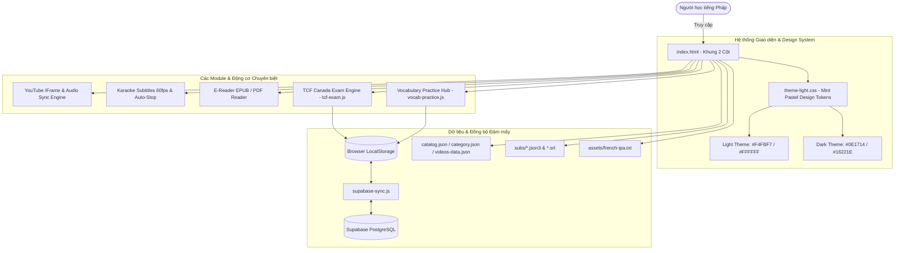

# 🇫🇷 Kiến trúc Hệ thống & Cấu trúc Thư mục Toàn dự án
## French Shadowing Studio (Mô hình Thiết kế & Phân bổ Tệp tin)

> **Tài liệu đặc tả kiến trúc, phân bổ thư mục, vai trò kỹ thuật của từng tệp và ma trận luồng dữ liệu của toàn bộ dự án French Shadowing Studio.**
> *Cập nhật: 25/10/2026 | Phiên bản: v2.0.0-light-redesign*

---

## 1. Tổng quan Kiến trúc Hệ thống (System Architecture)

**French Shadowing Studio** được xây dựng theo kiến trúc **Vanilla Web Application hiệu năng cao (Zero-bundler Architecture)**:
- **Tốc độ nạp tức thì (Zero Build Step):** Không phụ thuộc vào webpack/vite phức tạp, chạy trực tiếp trên trình duyệt hiện đại qua chuẩn mã nguồn ES6 Modules và Native Web APIs.
- **Khung giao diện Đa tầng (Layered UI):**
  - **Khung chính (index.html):** Bố cục 2 cột (5fr : 7fr) chuẩn hóa gồm Trình phát Video/Audio (7fr : 4fr), Karaoke Subtitles Timeline 60fps, E-Reader sách song ngữ, Tra từ & Từ khó.
  - **Hệ thống Design Tokens (theme-light.css):** Quản lý màu sắc Mint Pastel, độ tương phản chuẩn WCAG 4.5:1, hỗ trợ chuyển đổi mượt mà giữa **Light Mode** và **Dark Mode**.
  - **Phân hệ Khảo thí Thi thử TCF Canada (tcf-exam.js / css):** Engine phòng thi trắc nghiệm âm thanh, In-app dialogs, bảng giải thích bẫy đề thi và chấm điểm CEFR/CLB.
  - **Trung tâm Luyện tập Từ vựng (vocab-practice.js / css):** Động cơ Spaced Repetition (SRS SuperMemo SM-2) với 4 chế độ: Trắc nghiệm, Nghe & Điền từ, Ghép thẻ nhanh và Flashcard 3D.
  - **Lớp Đồng bộ Đám mây (supabase-sync.js / sql):** Lưu trữ dữ liệu từ vựng và tiến trình học tập lên PostgreSQL đám mây không máy chủ.



---

## 2. Sơ đồ Cây Thư mục Toàn diện (Directory Tree)

```text
/Users/linhvu/AI Project/Shadowing/
├── .agents/                                # Cấu hình và Custom Skills cho AI Assistant
│   ├── rules/
│   │   └── ANTIGRAVITY.md                  # Quy tắc đặc thù cho Antigravity IDE
│   └── skills/
│       └── ui-ux-pro-max/                  # Skill UI/UX Intelligence chuyên sâu
│           ├── SKILL.md                    # Hướng dẫn và cú pháp sử dụng skill
│           ├── data/                       # Cơ sở tri thức: styles, palettes, fonts, charts
│           ├── references/                 # Tài liệu quy chuẩn thiết kế mở rộng
│           └── scripts/                    # Scripts tra cứu thiết kế tự động
├── .vercel/                                # Metadata phục vụ triển khai tự động lên Vercel
│   ├── project.json                        # Cấu hình liên kết dự án Vercel
│   └── README.txt                          # Hướng dẫn môi trường Vercel CLI
├── assets/                                 # Tài nguyên ngôn ngữ tĩnh
│   └── french-ipa.txt                      # Bảng từ điển ánh xạ phiên âm quốc tế IPA tiếng Pháp
├── mockup-ref/                             # Các bản thiết kế gốc phục vụ kiểm chứng và đối chiếu
│   ├── Player.dc.html                      # Mockup khung phát Video & Audio
│   ├── Spec.dc.html                        # Mockup đặc tả giao diện tổng quát
│   ├── dark/                               # Mockup giao diện Tối (Dark Navy)
│   │   ├── Dark.dc.html                    # Màn hình giao diện tối
│   │   ├── README.md                       # Ghi chú thiết kế tối
│   │   ├── support.js                      # Script hỗ trợ mockup
│   │   └── vendor/                         # Thư viện ngoài phục vụ hiển thị mockup
│   └── light/                              # Mockup giao diện Sáng (Mint Pastel)
│       ├── Main.dc.html                    # Màn hình giao diện sáng
│       ├── README.md                       # Ghi chú thiết kế sáng
│       ├── support.js                      # Script hỗ trợ mockup
│       └── vendor/                         # Thư viện ngoài phục vụ hiển thị mockup
├── subs/                                   # Ngữ liệu phụ đề song ngữ Pháp - Việt của các bài học
│   ├── dwt1yeNtKeQ.fr.json3                # Phụ đề json3 đồng bộ cấp độ từng từ (Word-level)
│   ├── dwt1yeNtKeQ.fr.srt                  # Phụ đề tiếng Pháp câu thoại chuẩn
│   ├── dwt1yeNtKeQ.json3                   # Phụ đề gốc từ YouTube
│   ├── dwt1yeNtKeQ.srt                     # Phụ đề srt câu thoại
│   ├── kQUkpe9fNG0.fr.json3                # Phụ đề json3 word-level bài học ngữ pháp thì tương lai
│   ├── kQUkpe9fNG0.fr.srt                  # Phụ đề srt tiếng Pháp
│   ├── kQUkpe9fNG0.json3                   # Phụ đề json3 phân đoạn
│   ├── kQUkpe9fNG0.srt                     # Phụ đề srt đồng bộ
│   ├── sample_fr.fr.srt                    # Phụ đề mẫu Pháp
│   ├── sample_fr.srt                       # Phụ đề mẫu Pháp - Việt
│   └── sample_fr_vi.txt                    # Dữ liệu dịch câu mẫu tiếng Việt
├── userscript/                             # Tiện ích mở rộng trích xuất phụ đề trên trình duyệt
│   └── french-shadowing-youtube.user.js   # Tampermonkey Script lấy phụ đề YouTube tự động
├── AGENTS.md                               # Quy trình làm việc bắt buộc 4 bước (Mandatory AI Guidelines)
├── catalog.json                            # Danh mục video bài học chia theo cấp độ CEFR
├── category.json                           # Ánh xạ phân nhóm thể loại bài học
├── index.html                              # Tệp HTML trung tâm - Ứng dụng chính (Single Page App)
├── library-index.json                      # Danh mục chỉ mục sách E-Reader
├── PROJECT_STRUCTURE.md                    # Tài liệu này: Cấu trúc thư mục & giải thích toàn dự án
├── README.md                               # Tài liệu hướng dẫn sử dụng & tính năng tổng quan
├── supabase-schema.sql                     # Cấu trúc bảng PostgreSQL trên Supabase Cloud
├── supabase-sync.js                        # Động cơ đồng bộ dữ liệu đám mây Supabase
├── tcf-exam.css                            # Định kiểu giao diện phòng thi khảo thí TCF Canada
├── tcf-exam.js                             # Logic engine khảo thí thi thử TCF Canada
├── theme-light.css                         # Hệ thống Design Tokens Mint Pastel & Theme Overrides
├── vercel.json                             # Cấu hình triển khai, header cache & Clean URLs Vercel
├── videos-data.json                        # Dữ liệu chi tiết metadata của từng video bài học
├── vocab-practice.css                      # Định kiểu Trung tâm Luyện tập Từ vựng
└── vocab-practice.js                       # Logic động cơ luyện tập từ vựng & Spaced Repetition (SRS)
```

---

## 3. Bảng Phân tích Chi tiết Từng Tệp (File-by-File Breakdown)

### 3.1. Phân hệ Ứng dụng Chính (Core Application)

| Tệp tin | Kích thước / Dòng | Vai trò kỹ thuật & Chức năng chi tiết |
| :--- | :---: | :--- |
| [`index.html`](file:///Users/linhvu/AI%20Project/Shadowing/index.html) | ~22,925 dòng<br>~850 KB | **Trái tim của ứng dụng.** Khởi tạo bố cục 2 cột (5fr : 7fr), gắn bộ phát video YouTube IFrame API và HTML5 Audio, đồng bộ karaoke subtitle theo thời gian thực (60fps), trình đọc sách song ngữ E-Reader (hỗ trợ EPUB & PDF), phân tích ngữ pháp, dịch tự động, và các modal trợ giúp AI (Mod1, Mod2, BookMod). |
| [`theme-light.css`](file:///Users/linhvu/AI%20Project/Shadowing/theme-light.css) | ~9,859 dòng<br>~295 KB | **Hệ thống Design System toàn diện.** Khai báo Design Tokens chuẩn HSL/Hex (Mint Pastel: `--fs-bg`, `--fs-surface`, `--fs-primary`, `--fs-tint`, `--fs-accent-text`, `--g1b` đến `--gvb`). Định nghĩa toàn bộ kiểu dáng giao diện cho 10 Modules (L1 – L10), hỗ trợ Dark Theme tự động qua `data-theme="dark"` và bảo toàn giao diện gốc khi tắt `data-ui="light"`. |

---

### 3.2. Phân hệ Khảo thí Thi thử TCF Canada (TCF Exam Module)

| Tệp tin | Kích thước / Dòng | Vai trò kỹ thuật & Chức năng chi tiết |
| :--- | :---: | :--- |
| [`tcf-exam.js`](file:///Users/linhvu/AI%20Project/Shadowing/tcf-exam.js) | ~1,219 dòng<br>~48 KB | **Bộ máy khảo thí TCF Canada (Compréhension Orale).** Quản lý trạng thái phòng thi mô phỏng, đồng hồ đếm ngược, phân đoạn âm thanh theo câu hỏi, hệ thống hộp thoại xác nhận In-App bo tròn (`.tcf-confirm-box`), tính điểm và xếp loại chuẩn CEFR (A1–C2) / CLB (3–10), thẻ phân tích bẫy đề thi (*Pièges TCF*) và tính năng 1-click test đề mẫu `TcfExam.loadDemoTest()`. |
| [`tcf-exam.css`](file:///Users/linhvu/AI%20Project/Shadowing/tcf-exam.css) | ~638 dòng<br>~16 KB | **Định kiểu phòng thi TCF.** Thiết kế overlay phòng thi chuẩn quốc tế, thanh điều hướng số câu hỏi, bảng kết quả, huy hiệu cấp độ CEFR/CLB và thẻ xem lại giải thích chi tiết. |

---

### 3.3. Phân hệ Luyện tập Từ vựng & Ghi nhớ Giãn cách (Vocabulary Hub)

| Tệp tin | Kích thước / Dòng | Vai trò kỹ thuật & Chức năng chi tiết |
| :--- | :---: | :--- |
| [`vocab-practice.js`](file:///Users/linhvu/AI%20Project/Shadowing/vocab-practice.js) | ~1,988 dòng<br>~77 KB | **Động cơ Trung tâm Luyện tập Từ vựng (Vocabulary Practice Hub).** Triển khai thuật toán Spaced Repetition (SuperMemo SM-2) tính toán khoảng thời gian lặp lại và hệ số dễ dàng (*Ease factor*). Vận hành 4 chế độ: Trắc nghiệm phản xạ 4 đáp án (Quiz), Nghe & Điền từ khuyết (Cloze Test), Ghép thẻ nhanh (Fast Match 4×3), và Flashcard 3D lật mặt. |
| [`vocab-practice.css`](file:///Users/linhvu/AI%20Project/Shadowing/vocab-practice.css) | ~1,899 dòng<br>~39 KB | **Kiểu dáng nền tảng cho Vocabulary Hub.** Tạo hiệu ứng 3D lật thẻ (`perspective`, `transform-style: preserve-3d`), dải tiến trình gradient, hiệu ứng rung khi chọn sai (`@keyframes vphShake`), lưới thẻ ghép và bộ màu từ loại cho giao diện dark gốc. |

---

### 3.4. Phân hệ Cơ sở Dữ liệu & Đồng bộ Đám mây (Cloud Sync)

| Tệp tin | Kích thước / Dòng | Vai trò kỹ thuật & Chức năng chi tiết |
| :--- | :---: | :--- |
| [`supabase-schema.sql`](file:///Users/linhvu/AI%20Project/Shadowing/supabase-schema.sql) | 32 dòng<br>~1.2 KB | **Schema cơ sở dữ liệu PostgreSQL.** Tạo cấu trúc bảng `user_vocab` (lưu từ vựng, ngữ cảnh, nghĩa, videoId, trạng thái SRS), bảng `tcf_results` (lịch sử điểm thi TCF) kèm các chính sách bảo mật cấp hàng (Row Level Security - RLS). |
| [`supabase-sync.js`](file:///Users/linhvu/AI%20Project/Shadowing/supabase-sync.js) | ~864 dòng<br>~32 KB | **Bộ đồng bộ đám mây Supabase Client.** Tự động phát hiện thay đổi trên `localStorage`, đồng bộ 2 chiều (Local <-> Cloud), giải quyết xung đột thời gian (Last-Write-Wins), quản lý phiên đăng nhập và sao lưu kho từ vựng cá nhân. |
| [`vercel.json`](file:///Users/linhvu/AI%20Project/Shadowing/vercel.json) | 14 dòng<br>~320 B | **Cấu hình máy chủ Vercel Serverless CDN.** Kích hoạt `cleanUrls: true`, định cấu hình HTTP Response Headers bảo mật, CORS, và bộ nhớ đệm trình duyệt cho các tệp tĩnh. |

---

### 3.5. Danh mục Bài học & Ngữ liệu Phụ đề (Catalogs & Linguistics)

| Tệp tin / Thư mục | Định dạng | Vai trò kỹ thuật & Chức năng chi tiết |
| :--- | :---: | :--- |
| [`catalog.json`](file:///Users/linhvu/AI%20Project/Shadowing/catalog.json) | JSON | **Cây bài học theo cấp độ CEFR.** Phân loại danh sách video bài học theo các cấp độ: *Beginner (A1-A2), Intermediate (B1-B2), Advanced (C1-C2)* kèm thumbnail, tiêu đề và kênh phát hành. |
| [`category.json`](file:///Users/linhvu/AI%20Project/Shadowing/category.json) | JSON | Ánh xạ ID bài học với tiêu đề để hiển thị nhanh trên menu phân loại. |
| [`videos-data.json`](file:///Users/linhvu/AI%20Project/Shadowing/videos-data.json) | JSON | Metadata chi tiết của video: tác giả, thời lượng, mô tả, liên kết bài giảng. |
| [`library-index.json`](file:///Users/linhvu/AI%20Project/Shadowing/library-index.json) | JSON | Danh mục thư viện sách số hóa (EPUB/PDF) dùng cho module E-Reader. |
| `assets/french-ipa.txt` | TXT | Bảng tra cứu phiên âm quốc tế IPA cho hàng nghìn từ vựng tiếng Pháp thông dụng. |
| `subs/*.json3` | JSON3 | Dữ liệu phụ đề phân đoạn chi tiết đến từng từ (*Word-level timestamps*) phục vụ hiệu ứng chữ chạy karaoke 60fps. |
| `subs/*.srt` | SRT | Phụ đề câu tiêu chuẩn tiếng Pháp và tiếng Việt phục vụ chế độ hiển thị song ngữ. |
| `subs/sample_fr_vi.txt` | TXT | Ngữ liệu dịch thuật câu mẫu đối chiếu song song. |

---

### 3.6. Công cụ Mở rộng & Hỗ trợ Phát triển (Tools & Extensions)

| Tệp tin / Thư mục | Loại tài nguyên | Vai trò kỹ thuật & Chức năng chi tiết |
| :--- | :---: | :--- |
| `userscript/french-shadowing-youtube.user.js` | Tampermonkey Userscript | Tiện ích mở rộng chạy trực tiếp trên YouTube web để trích xuất phụ đề gốc chất lượng cao và chuyển đổi tự động sang định dạng của French Shadowing Studio. |
| `mockup-ref/` | HTML / CSS / JS | Các bản thiết kế tĩnh ban đầu (Light theme `Main.dc.html` và Dark theme `Dark.dc.html`) làm tiêu chuẩn đối sánh pixel-perfect khi hiện thực hóa mã nguồn. |
| [`AGENTS.md`](file:///Users/linhvu/AI%20Project/Shadowing/AGENTS.md) | Markdown | **Bộ quy tắc bắt buộc của trợ lý AI.** Định nghĩa nghiêm ngặt quy trình làm việc 4 bước (*Listen -> Plan -> Review -> Execute*), cấm cắt cụt mã (*No truncation*), và quy chuẩn bàn giao theo Module Cards. |
| `.agents/skills/ui-ux-pro-max/` | AI Design Skill | Bộ dữ liệu trí tuệ nhân tạo chuyên sâu về UI/UX: 79 styles thiết kế, 192 bảng màu sản phẩm, 74 bộ font chữ, 119 quy tắc trải nghiệm người dùng và 17 mẫu chuyển động GSAP. |

---

## 4. Ma trận Luồng Dữ liệu & Lưu trữ (Data Flow Matrix)

| Thực thể dữ liệu | Lưu trữ Cục bộ (Local) | Lưu trữ Đám mây (Cloud) | Module sử dụng chính |
| :--- | :--- | :--- | :--- |
| **Kho từ vựng cá nhân** | `localStorage["fss_vocab_list"]` | Supabase Table `user_vocab` | Tra từ, Hard List, Flashcard SRS |
| **Chu kỳ lặp lại SRS** | `item.srs: { ease, interval, reps, due }` | Supabase Column `srs_state` | Vocabulary Practice Hub (`vocab-practice.js`) |
| **Tiến độ chuỗi học (Streak)** | `localStorage["fss_streak_data"]` | Supabase Table `user_profiles` | Thanh trò chơi & Dashboard thống kê |
| **Lịch sử thi thử TCF** | `localStorage["fss_tcf_exam_history"]` | Supabase Table `tcf_results` | TCF Exam Module (`tcf-exam.js`) |
| **Tùy chọn giao diện (Theme)** | `localStorage["fss_theme_pref"]` (`light`/`dark`) | Đồng bộ qua profile người dùng | Navbar Theme Toggle (`theme-light.css`) |
| **Chế độ tự dừng câu (Auto-stop)**| `localStorage["fss_auto_stop"]` (`true`/`false`) | Cục bộ trên từng thiết bị | Player Control Header (`index.html`) |

---

## 5. Quy chuẩn Đóng góp & Phát triển (Developer Guidelines)

1. **Thêm một bài học / video mới:**
   - Đặt tệp phụ đề vào thư mục `subs/` theo cú pháp: `{videoId}.fr.json3` và `{videoId}.fr.srt`.
   - Khai báo metadata video vào `videos-data.json`.
   - Thêm video vào nhóm cấp độ tương ứng trong `catalog.json`.
2. **Nguyên tắc mở rộng giao diện (CSS Rules):**
   - Mọi quy tắc CSS cho giao diện Sáng mới phải được đặt trong vùng chọn `html[data-ui="light"]` tại `theme-light.css`.
   - Tuyệt đối không dùng mã màu Hex/RGB cố định trong các modal, luôn sử dụng các CSS Variables chuẩn hóa (`--fs-bg`, `--fs-surface`, `--fs-ink`, `--fs-border`, `--g1b`, `--g3t`, ...).
   - Đảm bảo khi gỡ bỏ thuộc tính `data-ui="light"` trên thẻ `<html>`, giao diện lập tức quay về bản Dark Navy gốc nguyên vẹn.
3. **Quy chuẩn mã nguồn JavaScript:**
   - Giữ mã nguồn dạng Vanilla ES6 thuần, không dùng các hàm đóng gói ngoài luồng.
   - Luôn sử dụng kỹ thuật Pre-warm audio trên các tương tác chạm đầu tiên để đảm bảo tương thích hoàn hảo trên thiết bị di động iOS Safari.
