# 🇫🇷 Kiến trúc Hệ thống & Cấu trúc Thư mục Toàn dự án
## French Shadowing Studio (Mô hình Thiết kế & Phân bổ Tệp tin)

> **Tài liệu đặc tả kiến trúc, phân bổ thư mục, vai trò kỹ thuật của từng tệp và ma trận luồng dữ liệu của toàn bộ dự án French Shadowing Studio.**
> *Cập nhật: 25/10/2026 | Phiên bản: v2.6.0-clean-root-architecture*

---

## 1. Tổng quan Kiến trúc Hệ thống (System Architecture)

**French Shadowing Studio** được xây dựng theo kiến trúc **Modular Vanilla Web Application hiệu năng cao (Zero-bundler & Build-assisted Architecture)**:
- **Kiến trúc Mã nguồn Module hóa (Clean Modular Separation):** Mã nguồn ban đầu từ tệp đơn khối (~22.926 dòng) và các tệp gốc đã được phân bổ triệt để vào các thư mục chuyên biệt:
  - Khung sườn template chính tại `src/index.src.html` (~345 dòng).
  - 16 tệp giao diện con (9 modals và 7 screens/views) tại thư mục `partials/`.
  - 22 tệp CSS chuyên biệt theo từng phân hệ giao diện tại thư mục `css/`.
  - 20 tệp JavaScript xử lý logic theo từng tính năng cốt lõi tại thư mục `js/`.
- **Thư mục Gốc Tối giản (Clean Root):** Gốc repository chỉ chứa các tệp cấu hình cốt lõi (`index.html`, `catalog.json`, `vercel.json`, `.vercelignore`, `README.md`...) và các thư mục dữ liệu, không còn các tệp css/js lẻ tẻ.
- **Tốc độ nạp tức thì & Tương thích 100% (Native Classic Scripts):** Toàn bộ script được giữ ở dạng classic script có thứ tự nạp chuẩn xác, bảo toàn tuyệt đối 187+ trình xử lý sự kiện `onclick` nội tuyến, biến toàn cục và hỗ trợ trình duyệt mọi nền tảng (kể cả Safari iOS cũ).
- **Quy trình Build Tự động Không Phụ thuộc (Zero-bundler Build Tooling):** Bộ công cụ `tools/restructure.py` bằng Python chuẩn, cho phép ghép nối lossless (`python3 tools/restructure.py build`) để sinh ra `index.html` hoàn chỉnh sẵn sàng phục vụ trực tiếp trên Vercel CDN mà không cần cài đặt node_modules hay bundler nặng nề.
- **Hệ thống Design Tokens (css/theme-light.css):** Quản lý màu sắc Mint Pastel, độ tương phản chuẩn WCAG 4.5:1, hỗ trợ chuyển đổi mượt mà giữa **Light Mode** và **Dark Mode**.
- **Phân hệ Khảo thí Thi thử TCF Canada (js/tcf-exam.js & css/tcf-exam.css):** Engine phòng thi trắc nghiệm âm thanh, In-app dialogs, bảng giải thích bẫy đề thi và chấm điểm CEFR/CLB.
- **Trung tâm Luyện tập Từ vựng (js/vocab-practice.js & css/vocab-practice.css):** Động cơ Spaced Repetition (SRS SuperMemo SM-2) với 4 chế độ: Trắc nghiệm, Nghe & Điền từ, Ghép thẻ nhanh và Flashcard 3D.
- **Lớp Đồng bộ Đám mây (js/supabase-sync.js & supabase-schema.sql):** Lưu trữ dữ liệu từ vựng và tiến trình học tập lên PostgreSQL đám mây không máy chủ.

```mermaid
graph TD
    User([Người học tiếng Pháp]) -->|Truy cập| ProdHTML[index.html - Production Build]
    
    subgraph Build_Pipeline [Hệ thống Build & Ghép nối Lossless]
        SrcHTML[src/index.src.html - Khung sườn 345 dòng] --> Builder[tools/restructure.py build]
        Partials[partials/*.html - 16 Partials: 9 Modals & 7 Views] --> Builder
        Builder --> ProdHTML
    end

    subgraph Modular_Stylesheets [Hệ thống CSS Modular - css/ - 22 files]
        ProdHTML --> CSSBase[02-base.css & 03-layout.css]
        ProdHTML --> CSSViews[04-view-reader.css, 05-view-catalog.css, 06-view-news.css, 11-view-translate.css]
        ProdHTML --> CSSControls[07-practice-modes.css .. 16-own-video.css]
        ProdHTML --> CSSMobile[17-mobile-tweaks.css .. 20-mobile-polish.css]
        ProdHTML --> CSSTcf[tcf-exam.css]
        ProdHTML --> CSSVocab[vocab-practice.css]
        ProdHTML --> Tokens[theme-light.css - Mint Pastel Tokens]
    end

    subgraph Modular_Scripts [Hệ thống JS Modular - js/ - 20 files]
        ProdHTML --> JSCore[01-core.js - State & YouTube API Loader]
        ProdHTML --> JSCatalog[01b-catalog.js - Catalogs & Netflix Rows]
        ProdHTML --> JSSubs[01c-subtitles.js - JSON3 / SRT Parser]
        ProdHTML --> JSPlayer[01d-player.js - Playback, Speed, Repeat Loop]
        ProdHTML --> JSTranslate[01e-translate-ai.js - 60fps Subtitle Renderer]
        ProdHTML --> JSLookup[01f-lookup.js - Dictionary & Audio Pronounce]
        ProdHTML --> JSVocab[01g-vocab-list.js - Vocab & SRS Flashcards]
        ProdHTML --> JSEbook[01h-ebook.js - EPUB/PDF Reader & IndexedDB]
        ProdHTML --> JSSupport[02-pv-helper.js .. 10-own-video.js]
        ProdHTML --> JSTcf[tcf-exam.js - TCF Exam Engine]
        ProdHTML --> JSVocabHub[vocab-practice.js - Practice Engine]
        ProdHTML --> JSCloud[supabase-sync.js - Cloud Sync Engine]
    end

    subgraph Storage_Data [Dữ liệu & Đồng bộ Đám mây]
        JSTcf --> LocalStore[(Browser LocalStorage)]
        JSVocabHub --> LocalStore
        JSEbook --> IDB[(IndexedDB: Books)]
        LocalStore <--> JSCloud
        JSCloud <--> CloudDB[(Supabase PostgreSQL)]
    end
```



---

## 2. Sơ đồ Cây Thư mục Toàn diện (Directory Tree)

```text
/Users/linhvu/AI Project/Shadowing/
├── .agents/                                # Cấu hình và Custom Skills cho AI Assistant
│   ├── rules/
│   │   └── ANTIGRAVITY.md                  # Quy tắc đặc thù cho Antigravity IDE
│   └── skills/
│       └── ui-ux-pro-max/                  # Skill UI/UX Intelligence chuyên sâu
├── .vercel/                                # Metadata phục vụ triển khai tự động lên Vercel
│   ├── project.json                        # Cấu hình liên kết dự án Vercel
│   └── README.txt                          # Hướng dẫn môi trường Vercel CLI
├── assets/                                 # Tài nguyên ngôn ngữ tĩnh
│   └── french-ipa.txt                      # Bảng từ điển ánh xạ phiên âm quốc tế IPA tiếng Pháp
├── css/                                    # Toàn bộ Stylesheets của dự án (22 files)
│   ├── 02-base.css                         # CSS nền tảng, thiết lập layer, typography
│   ├── 03-layout.css                       # Bố cục 2 cột (5fr : 7fr), thanh cuộn, container
│   ├── 04-view-reader.css                  # Kiểu dáng màn hình đọc sách song ngữ
│   ├── 05-view-catalog.css                 # Danh mục danh sách phát, catalog (#playlist-page-style)
│   ├── 06-view-news.css                    # Giao diện đọc báo tiếng Pháp
│   ├── 07-practice-modes.css               # Bộ chuyển giao diện luyện tập (#pv-style)
│   ├── 08-speed-control.css                # Ô hiển thị tốc độ & nút điều khiển (#df-style)
│   ├── 09-text-mode-fix.css                # Điều chỉnh chế độ toàn văn bản (#txt-mode-fix)
│   ├── 10-ios-fix.css                      # Tinh chỉnh giao diện trên iOS Safari (#ios-fix)
│   ├── 11-view-translate.css               # Giao diện luyện dịch Việt → Pháp (#vt-style)
│   ├── 12-video-timeline.css               # Thanh timeline dưới video (#vp-style)
│   ├── 13-default-controls.css             # Hàng điều khiển mặc định 2 hàng (#pv-ctl-style)
│   ├── 14-subtitle-card.css                # Thẻ phụ đề câu hiện tại (#cs-style)
│   ├── 15-ipa-highlight.css                # Tô sáng IPA, karaoke chữ chạy (#ipa-hl-style)
│   ├── 16-own-video.css                    # Khung nhập video YouTube cá nhân (#own-yt-style)
│   ├── 17-mobile-tweaks.css                # Tinh chỉnh di động / iPad (#mobile-tweaks)
│   ├── 18-controls-layout.css              # Bố cục hàng điều khiển trên mobile (#pv-ctl-layout)
│   ├── 19-vs-style.css                     # Màu sắc và độ đậm nhạt đánh dấu từ (#vs-style)
│   ├── 20-mobile-polish.css                # Đánh bóng giao diện điều khiển mobile (#mobile-polish)
│   ├── tcf-exam.css                        # Định kiểu phòng thi khảo thí TCF Canada
│   ├── theme-light.css                     # Hệ thống Design Tokens Mint Pastel & Theme Overrides
│   └── vocab-practice.css                  # Định kiểu Trung tâm Luyện tập Từ vựng
├── js/                                     # Toàn bộ Scripts của dự án (20 files)
│   ├── 01-core.js                          # Khởi tạo trạng thái, storage, icon SVG, Web Audio, YouTube API loader
│   ├── 01b-catalog.js                      # Danh mục video, Netflix row cards, playlist, lazy load
│   ├── 01c-subtitles.js                    # Bộ phân tích phụ đề JSON3/SRT, thuật toán chỉnh lệch tem thời gian
│   ├── 01d-player.js                       # Động cơ phát video/audio, kéo tốc độ, lặp câu, tự dừng
│   ├── 01e-translate-ai.js                 # Bộ kết xuất phụ đề 60fps, lời nhắc AI, dịch song ngữ
│   ├── 01f-lookup.js                       # Bôi đen tra từ, bảng từ điển ngữ pháp, phát âm Larousse
│   ├── 01g-vocab-list.js                   # Quản lý kho từ vựng đã lưu, từ khó, ôn tập SRS
│   ├── 01h-ebook.js                        # Trình đọc sách EPUB/PDF/DOCX, lưu IndexedDB, hash routing
│   ├── 02-pv-helper.js                     # Trợ lý giao diện luyện tập
│   ├── 03-practice-engine.js               # Động cơ chuyển đổi 4 chế độ luyện tập (#pv-script)
│   ├── 04-vt-helper.js                     # Trợ lý màn hình luyện dịch
│   ├── 05-translate-engine.js              # Động cơ dịch câu Việt → Pháp (#vt-script)
│   ├── 06-audio-sync.js                    # Đánh dấu từ đã lưu trong câu phụ đề (#vs-script)
│   ├── 07-timeline-cc.js                   # Thanh timeline tùy biến, nút CC, phụ đề trên video (#vp-script)
│   ├── 08-responsive-height.js             # Tính toán chiều cao linh hoạt trên di động/iPad
│   ├── 09-keyboard-fix.js                  # Khắc phục lỗi bàn phím ảo trên iOS (#kb-fix)
│   ├── 10-own-video.js                     # Xử lý luồng tải video YouTube riêng (#own-yt-script)
│   ├── supabase-sync.js                    # Động cơ đồng bộ dữ liệu đám mây Supabase
│   ├── tcf-exam.js                         # Động cơ khảo thí thi thử TCF Canada
│   └── vocab-practice.js                   # Động cơ luyện tập từ vựng & Spaced Repetition (SRS)
├── partials/                               # Các khối giao diện HTML con theo component (16 files)
│   ├── modal-bilingual.html                # Cài đặt phụ đề song ngữ (#bilingual-modal)
│   ├── modal-book-import.html              # Nạp & phân đoạn chương sách (#bk-import-modal)
│   ├── modal-book-translate.html           # Dịch song ngữ sách qua AI (#bk-tr-modal)
│   ├── modal-keyvocab.html                 # Trích xuất từ vựng quan trọng bằng AI (#keyvocab-modal)
│   ├── modal-punctuation.html              # Bảng phím ký tự dấu tiếng Pháp (#punct-modal)
│   ├── modal-review-srs.html               # Hộp thoại ôn tập từ vựng Spaced Repetition (#review-backdrop)
│   ├── modal-share.html                    # Hộp thoại chia sẻ bài luyện (#share-modal)
│   ├── modal-translate-ai.html             # Trợ lý AI dịch Việt → Pháp (#vt-ai-modal)
│   ├── modal-vocab-meaning.html            # Bảng tra nghĩa từ vựng hàng loạt (#vocab-meaning-modal)
│   ├── view-book.html                      # Màn hình đọc sách E-Reader (#screen-book)
│   ├── view-guide.html                     # Màn hình hướng dẫn cài extension (#screen-guide)
│   ├── view-home.html                      # Màn hình chính / Nhập link / Catalog (#screen-input)
│   ├── view-practice.html                  # Phòng luyện Shadowing, Karaoke & Split-panel (#screen-practice)
│   ├── view-translate.html                 # Màn hình luyện dịch Việt → Pháp (#screen-vt)
│   └── view-vocab.html                     # Màn hình danh sách từ vựng đã lưu (#screen-vocab)
├── src/                                    # Mã nguồn HTML gốc chưa build
│   └── index.src.html                      # Khung sườn HTML chính (chứa directive <!-- @include -->)
├── tools/                                  # Công cụ quản lý tái cấu trúc & build
│   ├── map-2a.json                         # Bản đồ trích xuất các khối standalone
│   ├── map-2b.json                         # Bản đồ chia tách khối JS 18 thành 8 module
│   ├── map-proposal.json                   # Đề xuất bản đồ cấu trúc tổng thể
│   ├── restructure.py                      # Bộ công cụ scan, extract, cut, build, verify
│   └── split-manifest.json                 # Manifest băm SHA256 và định tuyến tệp trích xuất
├── mockup-ref/                             # Các bản thiết kế gốc phục vụ kiểm chứng
├── subs/                                   # Ngữ liệu phụ đề song ngữ Pháp - Việt
├── userscript/                             # Tiện ích mở rộng trích xuất phụ đề YouTube
├── .gitignore                              # Danh sách bỏ qua của Git
├── .vercelignore                           # Danh sách loại trừ khi deploy lên Vercel
├── AGENTS.md                               # Quy trình làm việc bắt buộc của AI Assistant
├── catalog.json                            # Danh mục video bài học chia theo cấp độ CEFR
├── category.json                           # Ánh xạ phân nhóm thể loại bài học
├── index.html                              # Tệp HTML trung tâm (Production build từ src/ + partials/)
├── library-index.json                      # Danh mục chỉ mục sách E-Reader
├── PROJECT_STRUCTURE.md                    # Tài liệu này: Cấu trúc thư mục & giải thích toàn dự án
├── README.md                               # Hướng dẫn sử dụng & tính năng tổng quan
├── RESTRUCTURE-PLAN.md                     # Kế hoạch chi tiết tái cấu trúc index.html thành modular
├── supabase-schema.sql                     # Cấu trúc bảng PostgreSQL trên Supabase Cloud
├── vercel.json                             # Cấu hình triển khai, header cache & Clean URLs Vercel
└── videos-data.json                        # Dữ liệu chi tiết metadata của từng video bài học
```

---

## 3. Bảng Phân tích Chi tiết Từng Tệp (File-by-File Breakdown)

### 3.1. Phân hệ Khung Sườn & Partials (HTML Architecture)

| Tệp tin | Thư mục | Vai trò kỹ thuật & Chức năng chi tiết |
| :--- | :---: | :--- |
| [`index.html`](file:///Users/linhvu/AI%20Project/Shadowing/index.html) | Root | **Tệp HTML phân phối chính (Production Asset).** Được tạo tự động bởi `python3 tools/restructure.py build`. Đảm bảo phục vụ nhanh nhất cho Vercel CDN mà không cần server build. |
| [`index.src.html`](file:///Users/linhvu/AI%20Project/Shadowing/src/index.src.html) | `src/` | **Khung xương template ứng dụng (~345 dòng).** Chứa thẻ `<head>`, thẻ nạp stylesheet `css/*.css`, khung tooltip bôi đen, các chỉ thị `<!-- @include partials/... -->` và các thẻ nạp script `js/*.js`. |
| `modal-*.html` | `partials/` | **9 hộp thoại chuyên biệt:** Bảng cài đặt song ngữ, phím ký tự dấu, chia sẻ bài học, trích xuất từ vựng khó, tra nghĩa nhanh, ôn tập ngắt quãng (SRS), trợ lý AI dịch thuật, nạp sách và dịch song ngữ sách. |
| `view-*.html` | `partials/` | **6 màn hình chức năng chính:** `view-home` (Trang chủ & Netflix Rows), `view-practice` (Phòng luyện Shadowing & Player), `view-translate` (Luyện dịch Việt → Pháp), `view-vocab` (Từ vựng đã lưu), `view-guide` (Hướng dẫn cài đặt), `view-book` (Trình đọc sách E-Reader). |

---

### 3.2. Phân hệ Stylesheet Modular (`css/` - 22 files)

| Tệp tin | Vai trò kỹ thuật |
| :--- | :--- |
| `css/02-base.css` | Thiết lập nền tảng, thiết lập `@layer properties`, chuẩn hóa tỷ lệ kích thước. |
| `css/03-layout.css` | Khung chia 2 cột (5fr : 7fr), thanh cuộn, split-panel container. |
| `css/04-view-reader.css` | Định kiểu giao diện đọc sách E-Reader song ngữ, mục lục, ngăn kéo đọc. |
| `css/05-view-catalog.css` | Bố cục dạng thẻ phim Netflix, thanh cuộn ngang, danh mục bài học (`#playlist-page-style`). |
| `css/06-view-news.css` | Giao diện đọc báo và ngữ liệu tin tức tiếng Pháp. |
| `css/07-practice-modes.css` | Bộ chuyển 4 chế độ luyện tập: Tự do, Shadowing, Chép chính tả, Đọc theo câu (`#pv-style`). |
| `css/08-speed-control.css` | Ô hiển thị tốc độ phát (0.5x - 2.0x) và 2 nút tam giác tăng giảm (`#df-style`). |
| `css/09-text-mode-fix.css` | Tinh chỉnh hiển thị khi người dùng chọn chế độ toàn văn bản (`#txt-mode-fix`). |
| `css/10-ios-fix.css` | Tinh chỉnh vị trí nút và tương thích trên iOS Safari (`#ios-fix`). |
| `css/11-view-translate.css` | Định kiểu màn hình luyện dịch Việt → Pháp (`#vt-style`). |
| `css/12-video-timeline.css` | Thanh timeline dưới video, nút CC và nút phụ đề song ngữ (`#vp-style`). |
| `css/13-default-controls.css` | Hai hàng nút điều khiển phát/tạm dừng, lặp câu, tốc độ (`#pv-ctl-style`). |
| `css/14-subtitle-card.css` | Thẻ hiển thị phụ đề câu thoại hiện tại (`#cs-style`). |
| `css/15-ipa-highlight.css` | Hiệu ứng tô sáng phiên âm quốc tế IPA và chữ chạy karaoke (`#ipa-hl-style`). |
| `css/16-own-video.css` | Khung nạp liên kết video YouTube cá nhân của người học (`#own-yt-style`). |
| `css/17-mobile-tweaks.css` | Thẻ hướng dẫn và tương thích hiển thị trên điện thoại / iPad (`#mobile-tweaks`). |
| `css/18-controls-layout.css` | Tinh chỉnh bố cục cụm điều khiển phát trên màn hình nhỏ (`#pv-ctl-layout`). |
| `css/19-vs-style.css` | Màu sắc và độ đậm nhạt đánh dấu từ/cụm/câu đã lưu trong bài (`#vs-style`). |
| `css/20-mobile-polish.css` | Đánh bóng các nút điều khiển, bo góc và tối ưu vùng chạm trên mobile (`#mobile-polish`). |
| [`css/tcf-exam.css`](file:///Users/linhvu/AI%20Project/Shadowing/css/tcf-exam.css) | **Định kiểu phòng thi TCF.** Thiết kế overlay phòng thi chuẩn quốc tế, thanh điều hướng số câu hỏi, bảng kết quả, huy hiệu cấp độ CEFR/CLB và thẻ xem lại giải thích chi tiết. |
| [`css/vocab-practice.css`](file:///Users/linhvu/AI%20Project/Shadowing/css/vocab-practice.css) | **Kiểu dáng cho Vocabulary Hub.** Tạo hiệu ứng 3D lật thẻ (`perspective`, `transform-style: preserve-3d`), dải tiến trình gradient, hiệu ứng rung khi chọn sai (`@keyframes vphShake`), lưới thẻ ghép và bộ màu từ loại cho giao diện dark gốc. |
| [`css/theme-light.css`](file:///Users/linhvu/AI%20Project/Shadowing/css/theme-light.css) | **Hệ thống Design System toàn diện.** Khai báo Design Tokens HSL/Hex (Mint Pastel: `--fs-bg`, `--fs-surface`, `--fs-primary`, `--fs-tint`, `--fs-accent-text`, `--g1b` đến `--gvb`). Định nghĩa toàn bộ kiểu dáng giao diện cho 10 Modules (L1 – L10), hỗ trợ Dark Theme tự động qua `data-theme="dark"` và bảo toàn giao diện gốc khi tắt `data-ui="light"`. |

---

### 3.3. Phân hệ JavaScript Modular (`js/` - 20 files)

| Tệp tin | Vai trò kỹ thuật & Chức năng chi tiết |
| :--- | :--- |
| `js/01-core.js` | Khởi tạo trạng thái ứng dụng, hệ thống lưu trữ `localStorage`, kho biểu tượng SVG, Web Audio Context, và bộ nạp YouTube IFrame API. |
| `js/01b-catalog.js` | Quản lý danh mục bài học CEFR, danh sách phát, hàng thẻ phong cách Netflix, tính năng tìm kiếm và tải lười (lazy load). |
| `js/01c-subtitles.js` | Động cơ phân tích phụ đề JSON3 (cấp độ từng từ) và SRT, bộ thuật toán nắn chỉnh độ lệch tem thời gian (`AIC_*`). |
| `js/01d-player.js` | Trình phát video YouTube và HTML5 Audio, cơ chế kéo tốc độ mượt mà, lặp lại đoạn câu (A-B Loop), tự dừng cuối câu (Auto-stop). |
| `js/01e-translate-ai.js` | Trình kết xuất phụ đề đồng bộ 60fps, tạo câu lệnh AI (Prompts), dịch câu song ngữ Pháp - Việt. |
| `js/01f-lookup.js` | Xử lý sự kiện bôi đen văn bản, tra cứu nghĩa từ điển, bộ phân tích hình thái từ (Lemmatizer), phát âm chuẩn Larousse. |
| `js/01g-vocab-list.js` | Quản lý danh sách từ vựng đã lưu, phân loại từ khó, cơ chế ôn tập lặp lại ngắt quãng (SRS), đồng bộ với tiện ích mở rộng. |
| `js/01h-ebook.js` | Trình đọc sách điện tử đa định dạng (EPUB / PDF / DOCX), lưu trữ sách vào IndexedDB, điều hướng chương theo URL hash. |
| `js/02-pv-helper.js` | Tiện ích hỗ trợ giao diện thực hành và bộ đệm âm thanh. |
| `js/03-practice-engine.js` | Động cơ quản lý 4 chế độ luyện tập Shadowing chuyên sâu (`#pv-script`). |
| `js/04-vt-helper.js` | Tiện ích định dạng câu và phân đoạn màn hình luyện dịch. |
| `js/05-translate-engine.js` | Động cơ luyện dịch câu Việt → Pháp kèm chấm điểm đối chiếu (`#vt-script`). |
| `js/06-audio-sync.js` | Đánh dấu trực quan các từ đã lưu trực tiếp trên dòng phụ đề đang chạy (`#vs-script`). |
| `js/07-timeline-cc.js` | Thanh timeline dưới video, hiển thị phụ đề nổi CC trên video player (`#vp-script`). |
| `js/08-responsive-height.js` | Tự động đo đạc và điều chỉnh chiều cao khung phát trên màn hình xoay dọc di động/iPad. |
| `js/09-keyboard-fix.js` | Ngăn chặn lỗi bàn phím ảo che khuất vùng nhập liệu trên iOS (`#kb-fix`). |
| `js/10-own-video.js` | Xử lý luồng tải video YouTube ngoài bằng ID hoặc đường dẫn URL (`#own-yt-script`). |
| [`js/tcf-exam.js`](file:///Users/linhvu/AI%20Project/Shadowing/js/tcf-exam.js) | **Bộ máy khảo thí TCF Canada (Compréhension Orale).** Quản lý trạng thái phòng thi mô phỏng, đồng hồ đếm ngược, phân đoạn âm thanh theo câu hỏi, hệ thống hộp thoại xác nhận In-App bo tròn (`.tcf-confirm-box`), tính điểm và xếp loại chuẩn CEFR (A1–C2) / CLB (3–10), thẻ phân tích bẫy đề thi (*Pièges TCF*) và tính năng 1-click test đề mẫu `TcfExam.loadDemoTest()`. |
| [`js/vocab-practice.js`](file:///Users/linhvu/AI%20Project/Shadowing/js/vocab-practice.js) | **Động cơ Trung tâm Luyện tập Từ vựng (Vocabulary Practice Hub).** Triển khai thuật toán Spaced Repetition (SuperMemo SM-2) tính toán khoảng thời gian lặp lại và hệ số dễ dàng (*Ease factor*). Vận hành 4 chế độ: Trắc nghiệm phản xạ 4 đáp án (Quiz), Nghe & Điền từ khuyết (Cloze Test), Ghép thẻ nhanh (Fast Match 4×3), và Flashcard 3D lật mặt. |
| [`js/supabase-sync.js`](file:///Users/linhvu/AI%20Project/Shadowing/js/supabase-sync.js) | **Bộ đồng bộ đám mây Supabase Client.** Tự động phát hiện thay đổi trên `localStorage`, đồng bộ 2 chiều (Local <-> Cloud), giải quyết xung đột thời gian (Last-Write-Wins), quản lý phiên đăng nhập và sao lưu kho từ vựng cá nhân. |

---

### 3.4. Công cụ Quản lý Tái cấu trúc & Build (`tools/`)

| Tệp tin | Vai trò kỹ thuật & Chức năng chi tiết |
| :--- | :--- |
| `tools/restructure.py` | Script Python chuẩn (không phụ thuộc thư viện ngoài) cung cấp 5 lệnh chính:<br>• `scan`: Quét và thống kê các khối inline CSS/JS cùng số lượt tham chiếu `refs`.<br>• `extract`: Trích xuất các khối CSS/JS ra file riêng theo bản đồ cấu hình `map.json` kèm hash `--bust`.<br>• `cut`: Cắt một phần tử HTML (theo `id`) ra file partial độc lập và để lại thẻ include.<br>• `build`: Ghép nối `src/index.src.html` cùng các partials để sinh `index.html` hoàn chỉnh.<br>• `verify`: Kiểm thử toàn vẹn từng byte (Lossless SHA-256) so với bản gốc. |
| `tools/split-manifest.json` | Tệp kê khai toàn bộ các vị trí đã trích xuất, mã băm SHA256 gốc và các đường dẫn partials. |
| `tools/map-2a.json` | Bản đồ trích xuất các khối CSS/JS độc lập (Phiên 2a). |
| `tools/map-2b.json` | Bản đồ chia tách khối JS chính (12.916 dòng) thành 8 module chức năng (Phiên 2b). |

---

## 4. Ma trận Luồng Dữ liệu & Lưu trữ (Data Flow Matrix)

| Thực thể dữ liệu | Lưu trữ Cục bộ (Local) | Lưu trữ Đám mây (Cloud) | Module sử dụng chính |
| :--- | :--- | :--- | :--- |
| **Kho từ vựng cá nhân** | `localStorage["fss_vocab_list"]` | Supabase Table `user_vocab` | Tra từ, Hard List, Flashcard SRS |
| **Chu kỳ lặp lại SRS** | `item.srs: { ease, interval, reps, due }` | Supabase Column `srs_state` | Vocabulary Practice Hub (`js/vocab-practice.js`) |
| **Tiến độ chuỗi học (Streak)** | `localStorage["fss_streak_data"]` | Supabase Table `user_profiles` | Thanh trò chơi & Dashboard thống kê |
| **Lịch sử thi thử TCF** | `localStorage["fss_tcf_exam_history"]` | Supabase Table `tcf_results` | TCF Exam Module (`js/tcf-exam.js`) |
| **Tùy chọn giao diện (Theme)** | `localStorage["fss_theme_pref"]` (`light`/`dark`) | Đồng bộ qua profile người dùng | Navbar Theme Toggle (`css/theme-light.css`) |
| **Chế độ tự dừng câu (Auto-stop)**| `localStorage["fss_auto_stop"]` (`true`/`false`) | Cục bộ trên từng thiết bị | Player Control Header (`js/01d-player.js`) |
| **Dữ liệu Sách E-Reader** | IndexedDB: `fss_books_db` | Lưu cục bộ trên thiết bị | Trình đọc sách song ngữ (`js/01h-ebook.js`) |

---

## 5. Quy chuẩn Đóng góp & Quy trình Phát triển (Developer Workflow)

### 5.1. Quy trình Chỉnh sửa Giao diện HTML
1. **Không sửa trực tiếp `index.html`:** Tệp `index.html` là kết quả build tự động.
2. **Sửa ở đâu:**
   - Nếu sửa khung trang, các thẻ `<head>`, link CSS hoặc script: sửa tại `src/index.src.html`.
   - Nếu sửa màn hình hoặc hộp thoại cụ thể: sửa tại tệp tương ứng trong `partials/` (ví dụ: sửa giao diện Luyện tập thì sửa `partials/view-practice.html`).
3. **Chạy lệnh build để cập nhật:**
   ```bash
   python3 tools/restructure.py build
   ```
4. Kiểm tra lại `git status` và commit cả các tệp partials lẫn `index.html`.

### 5.2. Quy trình Chỉnh sửa CSS & JS
1. Sửa trực tiếp trong các module chuyên biệt tại `css/` hoặc `js/`.
2. Giữ nguyên tính chất classic script của JS (không dùng `type="module"`, không thêm `defer`/`async` làm hỏng thứ tự khởi tạo và các hàm gọi qua thuộc tính `onclick`).
3. Với CSS giao diện sáng: Mọi quy tắc CSS cho giao diện Sáng mới phải được đặt trong vùng chọn `html[data-ui="light"]` tại `css/theme-light.css` và dùng các biến CSS chuẩn hóa (`--fs-bg`, `--fs-surface`, `--fs-primary`, `--fs-ink`, `--g1b`, ...).

### 5.3. Thêm Bài học / Video Mới
1. Đặt tệp phụ đề vào thư mục `subs/` theo cú pháp: `{videoId}.fr.json3` và `{videoId}.fr.srt`.
2. Khai báo metadata video vào `videos-data.json`.
3. Thêm video vào nhóm cấp độ tương ứng trong `catalog.json`.
