# BÁO CÁO PHÂN TÍCH TRÙNG LẶP & KIẾN TRÚC THÔNG TIN (DUPLICATION & IA)
## Dự án: French Shadowing Studio (FSS)
**Tài liệu:** `audit/menu-navigation/MENU_DUPLICATION_REPORT.md`  
**Ngày thực hiện:** 2026-11-07  
**Chế độ:** READ-ONLY AUDIT  

---

## 1. PHÂN LOẠI TRÙNG LẶP MENU (DUPLICATION ANALYSIS)

Qua khảo sát toàn diện 34 Menu Definitions và 196 Menu Items, hệ thống ghi nhận các dạng trùng lặp sau:

### 1.1. Trùng lặp Hợp lý theo Thiết bị (Intentional Responsive Duplication)
Đây là các thành phần được cố tình hiển thị ở 2 vị trí khác nhau để tối ưu hóa trải nghiệm trên Desktop và Mobile:
1. **Từ vựng đã lưu:**
   - *Desktop:* Nút viên thuốc trên thanh header trang chủ (`.vocab-btn.home-top-btn`) kèm số lượng badge.
   - *Mobile:* Nằm trong Mobile Navigation Drawer (`MN-02.6`) khi bấm hamburger menu `☰`.
   - *Đánh giá:* **Hợp lý**, giữ nguyên.
2. **Đồng bộ Đám mây (Supabase):**
   - *Desktop:* Nút `#btn-cloud-sync` trên header trang chủ với đèn tín hiệu trạng thái kết nối.
   - *Mobile:* Nằm trong Mobile Navigation Drawer (`MN-02.7`).
   - *Đánh giá:* **Hợp lý**, giữ nguyên.
3. **Chế độ Sáng / Tối:**
   - *Desktop:* Nút tròn icon Mặt trời/Mặt trăng trên header.
   - *Mobile:* Mục chọn đầy đủ nhãn trong Drawer (`MN-02.8`).
   - *Đánh giá:* **Hợp lý**, giữ nguyên.

---

### 1.2. Trùng lặp Chức năng Không cần thiết (Functional Duplication)
Các mục điều hướng cùng xuất hiện đồng thời trên cùng một màn hình (đặc biệt trên màn hình Desktop rộng):
1. **Đồng bộ Đám mây trên Header Phòng Luyện vs Sandwich Menu:**
   - Trên Desktop (màn hình $\ge 641\text{px}$): Người dùng nhìn thấy nút `.cloud-sync-btn.practice-sync-btn` ngay trên thanh header.
   - Khi bấm vào nút Sandwich Menu (`#practice-sandwich-btn`) ở cùng góc phải header, mục đầu tiên lại là `"Đồng bộ đám mây"` (`.psm-item`).
   - *Ảnh hưởng:* Trùng lặp 2 nút cùng mở `#fss-cloud-modal` cách nhau vài chục pixel.
   - *Đề xuất:* Trên Desktop, nếu nút header đã hiển thị, có thể ẩn bớt mục này trong Sandwich Menu, hoặc chỉ hiển thị trong Sandwich Menu khi màn hình thu nhỏ (Mobile).
2. **Chế độ Sáng / Tối trên Header Phòng Luyện vs Sandwich Menu:**
   - Nút `.practice-theme-btn` nằm trên header phòng luyện tập.
   - Mục `"Chuyển chế độ Sáng / Tối"` cũng nằm trong Sandwich Menu.
   - *Đề xuất:* Tương tự mục Đồng bộ Đám mây.
3. **Bật/Tắt Dịch Song ngữ (Bilingual) tại 3 vị trí trong Bài báo:**
   - Nút tròn 문A trên thanh audio player (`#art-translate-btn`).
   - Nút `"Dịch song ngữ"` trên sidebar bài báo (`#art-side-bilingual-btn`).
   - Nút `"Dịch Song ngữ"` trong Sandwich Menu (`#psm-btn-bilingual`).
   - *Đánh giá:* Người dùng có tới 3 nơi khác nhau trên cùng một màn hình để thực hiện cùng 1 hành động `toggleBilingual()`.
4. **Nút "Sửa bản dịch song ngữ":**
   - Nút trên sidebar bài báo (`#art-side-edit-trans-btn`).
   - Nút trong Sandwich Menu (`MN-05.7`).
   - Cả hai đều gọi `openBilingualModal(true)`.

---

### 1.3. Trùng lặp Cấu trúc Rác trong DOM (Structural Duplication & Dead DOM)
1. **Cụm điều khiển phụ đề cũ `#practice-header-tools`:**
   - Tệp `partials/view-practice.html` (dòng 58–200) chứa hơn 140 dòng mã HTML của các nút: `#fs-wrap` (Cỡ chữ Aa), `#cs-ipa` (IPA), `#btn-toggle-karaoke`, `#btn-toggle-bilingual`, `#btn-edit-bilingual`, `#btn-toggle-autostop`, `#btn-toggle-autoscroll`, `#btn-punct`, `#btn-keyvocab`, `#btn-tcf-exam`.
   - Toàn bộ khối này bị đóng băng bằng `style="display:none !important;"` và chú thích: *(ẩn trên toàn bộ giao diện; gom vào Sandwich Menu)*.
   - *Hậu quả:*
     - Tăng kích thước tệp tải về không cần thiết (~6KB DOM rác).
     - Gây xung đột logic JavaScript: Ví dụ hàm `toggleTextSizePanel` trong `js/04-vt-helper.js` vẫn truy vấn `#fs-btn` (nằm trong khối ẩn này) để set attribute `aria-expanded`!
2. **Trùng lặp DOM ID `#sub-search-input` và Khối `#sub-search-bar` bị khóa chết:**
   - Khối `#sub-search-bar` (dòng 664–699) bị ẩn vĩnh viễn bằng `style="display:none !important;"`.
   - Bên trong chứa một `<input id="sub-search-input">`.
   - Trong khi đó, thanh tìm kiếm mở rộng mới ở header (`#sub-panel-hd`, dòng 438) lại chứa một `<input id="sub-search-input">` thứ hai!
   - *Hậu quả nghiêm trọng:* Vi phạm tính duy nhất của DOM ID trong HTML chuẩn (W3C Validator Fail). Lệnh `document.getElementById('sub-search-input')` có thể trả về phần tử ẩn khiến người dùng gõ phím không ăn hoặc mất focus!
   - Ngoài ra, hai tính năng quan trọng là **Sao chép phụ đề (`#btn-copy-transcript`)** và **Chia sẻ video (`#btn-share`)** bị "chôn vùi" vĩnh viễn trong khối ẩn này mà không có lối truy cập nào khác trong giao diện!

---

### 1.4. Bất nhất về Tên gọi & Hành vi (Inconsistent Behavior & Terminology)

| Thuật ngữ / Chức năng | Vị trí A | Vị trí B | Vị trí C | Đánh giá bất nhất |
|---|---|---|---|---|
| **Điều hướng Quay lại** | *"Luyện video khác"* (Practice header) | *"Quay lại"* (Vocab topbar) | *"Thư viện"* (E-Book & Translate topbar) | Cùng là quay về trang chủ nhưng dùng 4 nhãn khác nhau |
| **Từ khó (Key Vocab)** | *"Từ khó"* (Tab chuyển panel phải) | *"Từ vựng khó (AI)"* (Sandwich menu mở Modal) | *"Từ khó AI"* (Sidebar bài báo mở Modal) | Cùng nhãn "Từ khó" nhưng Tab thì lọc danh sách, còn nút khác thì mở Modal lấy prompt AI |
| **Căn mốc Audio** | *"Căn mốc tự động"* (Vocab bar - chạy ASR local) | *"Căn mốc Audio (AI)"* (Sidebar bài báo - mở Modal prompt) | — | Cùng động từ "Căn mốc" nhưng cơ chế hoạt động hoàn toàn khác nhau |
| **Chuyển Theme** | `toggleFsTheme()` (Trang chủ & Phòng luyện) | `toggleTheme()` (Translate screen) | — | **LỖI CODE:** `view-translate.html` gọi `toggleTheme()` không tồn tại, gây lỗi JS crash |
| **Giao diện Modal Cloud** | Dark Navy cố định (`bg-[#0b1329]`) | Không theo Design Token | Toàn app đang Light Theme | Phá vỡ tính nhất quán của hệ thống Mint Pastel Light Mode |

---

## 2. SƠ ĐỒ CÂY CẤU TRÚC KIẾN TRÚC THÔNG TIN HIỆN TẠI (CURRENT IA TREE)

```mermaid
graph TD
  App["French Shadowing Studio"]
  
  %% MÀN HÌNH 1: TRANG CHỦ
  App --> Home["Trang chủ (#screen-input)"]
  Home --> HomeTopNav["Top Nav Bar (MN-01)"]
  HomeTopNav --> Brand["Logo & Title"]
  HomeTopNav --> VocabLink1["Từ vựng đã lưu"]
  HomeTopNav --> CloudLink1["Đồng bộ Cloud"]
  HomeTopNav --> ThemeToggle1["Theme Sáng/Tối"]
  HomeTopNav --> HamBtn["Hamburger Button (Mobile)"]
  
  HamBtn -.-> Drawer["Mobile Navigation Drawer (MN-02)"]
  Drawer --> D1["Luyện Video"]
  Drawer --> D2["Đọc báo tiếng Pháp"]
  Drawer --> D3["Đọc sách"]
  Drawer --> D4["Luyện dịch câu"]
  Drawer --> D5["Video của bạn"]
  Drawer --> D6["Từ vựng đã lưu"]
  Drawer --> D7["Đồng bộ Cloud"]
  Drawer --> D8["Theme Sáng/Tối"]
  
  Home --> HomeBody["Các phân vùng chức năng"]
  HomeBody --> ModeVideo["1. Luyện nghe qua YouTube"]
  HomeBody --> ModeArticle["2. Đọc báo tiếng Pháp (MN-34)"]
  HomeBody --> ModeBook["3. Đọc cả một cuốn sách"]
  HomeBody --> ModeTranslate["4. Luyện dịch Việt → Pháp"]
  HomeBody --> ModeCustom["5. Video của bạn (MN-34)"]
  HomeBody --> HistorySection["Lịch sử đã luyện (MN-28, MN-29)"]
  
  %% MÀN HÌNH 2: PHÒNG LUYỆN TẬP
  App --> Practice["Phòng luyện tập (#screen-practice)"]
  Practice --> PracHeader["Practice Top Bar (MN-03)"]
  PracHeader --> BackHome["Quay lại Trang chủ"]
  PracHeader --> VocabLink2["Từ vựng (bài này)"]
  PracHeader --> CloudLink2["Đồng bộ Cloud (Desktop)"]
  PracHeader --> ThemeToggle2["Theme Sáng/Tối (Desktop)"]
  PracHeader --> ViewSwitch["Chọn giao diện (MN-04)"]
  PracHeader --> SandwichBtn["Sandwich Menu 3 sọc (MN-05)"]
  
  ViewSwitch --> VDefault["Giao diện Mặc định"]
  ViewSwitch --> VShadowing["Giao diện Shadowing (MN-14)"]
  ViewSwitch --> VDictation["Giao diện Chép chính tả (MN-15, MN-16, MN-17)"]
  
  SandwichBtn -.-> SandwichMenu["Sandwich Menu Items (15 mục)"]
  SandwichMenu --> SM_Cloud["Đồng bộ đám mây (TRÙNG)"]
  SandwichMenu --> SM_Theme["Theme Sáng/Tối (TRÙNG)"]
  SandwichMenu --> SM_Font["Cỡ chữ & Giãn dòng (MN-06)"]
  SandwichMenu --> SM_Toggles["Karaoke / Song ngữ / Tự dừng / AutoScroll / IPA"]
  SandwichMenu --> SM_Modals["Dấu câu AI / Từ khó AI / Thi thử TCF"]
  SandwichMenu --> SM_AiProvider["Bộ chọn AI tra nghĩa (ChatGPT / Gemini / Google)"]
  
  VDefault --> SplitLeft["Khu vực Video & Player Controls (MN-08, MN-09)"]
  VDefault --> SplitRight["Khu vực Phụ đề & Tabs (MN-10)"]
  VDefault --> ArtBar["Player bài báo & Điều hướng câu (MN-11, MN-12)"]
  VDefault --> ArtSide["Sidebar bài báo (MN-13)"]
  
  %% MÀN HÌNH 3: SỔ TỪ VỰNG
  App --> VocabScreen["Sổ từ vựng (#screen-vocab)"]
  VocabScreen --> VocabTop["Topbar chức năng (MN-18)"]
  VocabTop --> VBack["Quay lại"]
  VocabTop --> VAutoAlign["Căn mốc tự động"]
  VocabTop --> VHub["Luyện tập SRS (MN-20, MN-21)"]
  VocabTop --> VMeaningAI["Điền nghĩa AI"]
  VocabTop --> VExport["Xuất CSV"]
  VocabTop --> VImport["Import xem trước"]
  VocabScreen --> VocabFilter["Thanh tìm kiếm & Bộ lọc (MN-19)"]
  
  %% MÀN HÌNH 4: ĐỌC SÁCH
  App --> BookScreen["Đọc sách (#screen-book)"]
  BookScreen --> BookTop["Header điều khiển (MN-22)"]
  BookScreen --> BookDrawer["Drawer Mục lục & Tìm kiếm (MN-23)"]
  BookScreen --> BookSettings["Cài đặt nền & chữ (MN-24)"]
  BookScreen --> BookBottom["Thanh trượt chương & tiến độ (MN-25)"]
  
  %% MÀN HÌNH 5: LUYỆN DỊCH
  App --> TransScreen["Luyện dịch (#screen-vt)"]
  TransScreen --> TransHeader["Header Luyện dịch (MN-26)"]
  TransScreen --> TransNav["Điều hướng câu dịch (MN-27)"]
```

---

## 3. ĐÁNH GIÁ ĐỘ SÂU & KHẢ NĂNG KHÁM PHÁ (DISCOVERABILITY & DEPTH)

1. **Độ sâu điều hướng (Navigation Depth):**
   - Hầu hết màn hình nằm ở cấp độ 1 (Level 1: Flat SPA Router).
   - Tuy nhiên, một số tính năng bị lồng tới **cấp độ 3 hoặc 4**:
     - *Ví dụ 1 (Đổi AI tra nghĩa):* Mở video $\rightarrow$ Bấm Menu Sandwich $\rightarrow$ Cuộn xuống dưới cùng $\rightarrow$ Chọn radio button.
     - *Ví dụ 2 (Luyện dịch câu trong SRS):* Mở Sổ từ vựng $\rightarrow$ Bấm Luyện tập SRS $\rightarrow$ Bấm Menu Sandwich của Hub $\rightarrow$ Chọn "Dịch Việt → Pháp".
2. **Khả năng khám phá chức năng (Discoverability):**
   - **Tốt:** Các chế độ học chính ở trang chủ rõ ràng, có mô tả chi tiết và icon trực quan.
   - **Kém:**
     - Nút "Sửa câu phụ đề" chỉ xuất hiện khi di chuột hoặc tương tác sâu vào từng câu.
     - Nút "Sao chép phụ đề" và "Chia sẻ video" bị ẩn 100% trong `#sub-search-bar` khiến người dùng không biết tính năng này tồn tại.
     - Người dùng máy tính bảng khó phân biệt giữa tab "Từ khó" bên phải và nút "Từ vựng khó (AI)" trong Sandwich menu.

---

## 4. ĐỀ XUẤT TỐI ƯU HÓA KIẾN TRÚC THÔNG TIN (PROPOSED IA REFACTORING)

> *Lưu ý: Đây là đề xuất kiến trúc thuần túy phục vụ đánh giá, không tự ý triển khai mã nguồn khi chưa được phê duyệt.*

1. **Loại bỏ triệt để Dead Markup:**
   - Xóa bỏ khối `#practice-header-tools` bị ẩn vô hiệu trong `partials/view-practice.html`.
   - Xóa bỏ khối `#sub-search-bar` bị ẩn; di chuyển 2 nút **Sao chép phụ đề (`copyTranscript`)** và **Chia sẻ video (`shareCurrentVideo`)** lên thanh công cụ của `#sub-panel-hd` (ngay cạnh ô tìm kiếm mở rộng).
2. **Khắc phục xung đột ID:** Đổi tên hoặc loại bỏ phần tử trùng lặp `#sub-search-input`.
3. **Thống nhất nhãn điều hướng Quay lại:**
   - Dùng chung nhãn `"← Trang chủ"` hoặc `"← Quay lại"` trên toàn bộ 5 màn hình (`practice`, `vocab`, `book`, `translate`, `guide`).
4. **Hợp nhất menu điều khiển trên Desktop:**
   - Khi ở màn hình Desktop rộng, Sandwich Menu nên tự động ẩn đi các mục đã xuất hiện trực tiếp trên header (như Đổi Theme, Đồng bộ Cloud) để tránh trùng lặp dư thừa.
5. **Đồng bộ hóa Theme của Cloud Sync Modal:**
   - Tái cấu trúc CSS của `#fss-cloud-modal` sang sử dụng semantic tokens (`var(--fs-surface-card)`, `var(--fs-border-base)`, `var(--fs-ink)`) để modal hòa nhập hoàn hảo với Light Mode.
