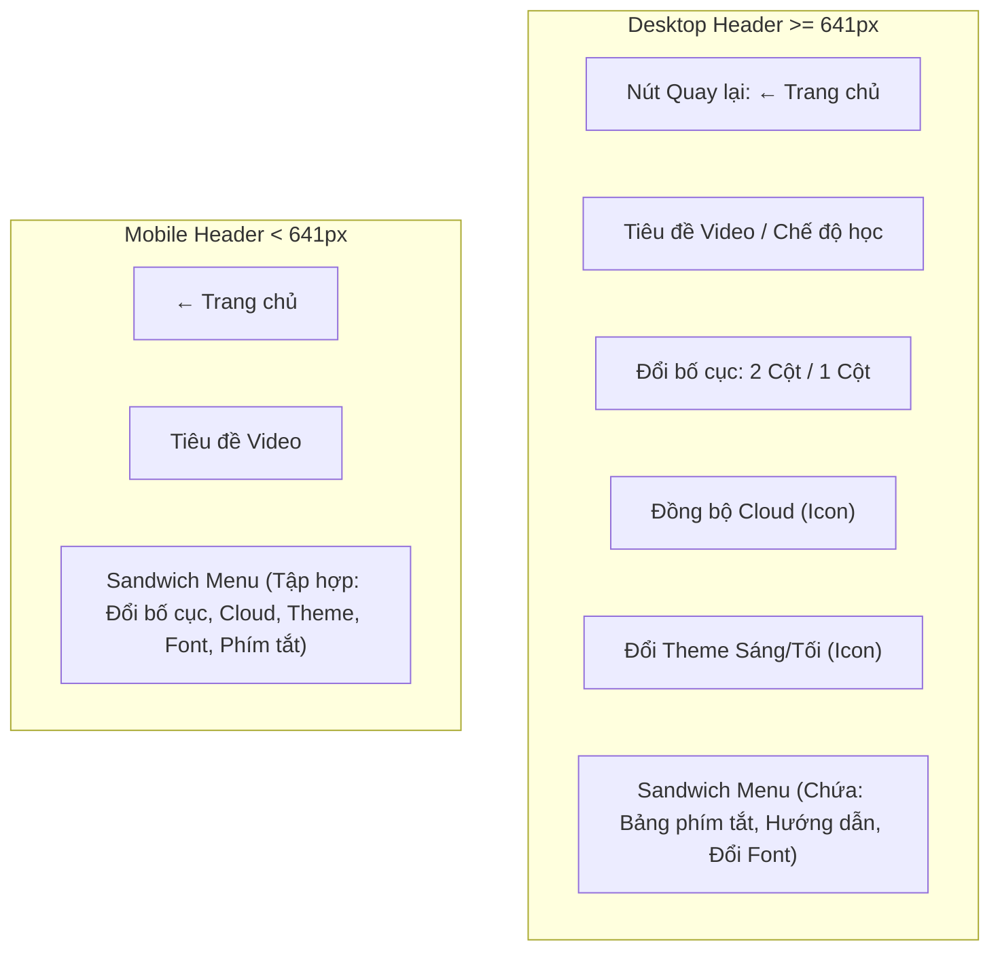
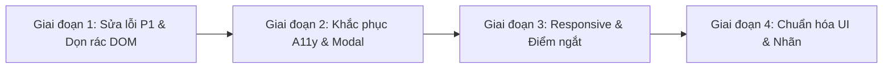

# KẾ HOẠCH & ĐỀ XUẤT TÁI CẤU TRÚC HỆ THỐNG MENU (MENU REFACTOR RECOMMENDATIONS)
## Dự án: French Shadowing Studio (FSS)
**Tài liệu:** `audit/menu-navigation/MENU_REFACTOR_RECOMMENDATIONS.md`  
**Ngày lập:** 2026-11-07  
**Tác giả:** Senior Frontend Architect & UI/UX Auditor  
**Chế độ:** Đề xuất kỹ thuật (Chưa áp dụng vào mã nguồn — Chờ phê duyệt)

---

## 1. MỤC TIÊU & NGUYÊN TẮC TÁI CẤU TRÚC

Bản kế hoạch này nhằm giải quyết triệt để 15 vấn đề kỹ thuật (từ P1 đến P3) đã được phát hiện và kiểm chứng trong quá trình audit thực tế bằng Chrome DevTools Protocol (CDP), đồng thời tối ưu hóa kiến trúc thông tin (IA) và nâng cao trải nghiệm người dùng theo chuẩn WCAG 2.2 AA.

### 4 Nguyên tắc cốt lõi bắt buộc tuân thủ:
1. **Tuân thủ quy trình Post-Split HTML:** Tuyệt đối không sửa tay `index.html`. Mọi chỉnh sửa HTML phải thực hiện trong `src/index.src.html` hoặc `partials/*.html`, sau đó chạy lệnh `python3 tools/restructure.py build` để sinh lại `index.html`.
2. **Bảo tồn kiến trúc Classic Scripts:** Giữ nguyên các hàm toàn cục (`window.*`), không tùy tiện đổi sang ES Modules (`type="module"`) hay thêm `defer`/`async` làm đứt gãy inline event handlers (`onclick`, `onchange`).
3. **Tuân thủ ngân sách màu & Design Tokens:** Tuyệt đối không thêm mã màu HEX cứng tùy tiện. Toàn bộ màu sắc mới phải kế thừa từ biến CSS Semantic (`--fs-*`) hoặc bảng màu Tailwind đã được phê duyệt trong `tools/lint-color.js`.
4. **Triển khai theo từng Module Delivery Unit:** Mỗi module can thiệp không quá 5 tệp, có tiêu chí nghiệm thu (DoD) rõ ràng, và chỉ thực thi khi người dùng phê duyệt bằng từ khóa `"Đồng ý"` hoặc `"Duyệt M#"`.

---

## 2. ĐỀ XUẤT TÁI CẤU TRÚC KIẾN TRÚC THÔNG TIN (IA PROPOSAL)

### 2.1. Hợp nhất & Tối ưu hóa Header Navigation
- **Vấn đề hiện tại:** Trên màn hình Desktop, nút "Đồng bộ Cloud" và "Đổi giao diện Sáng/Tối" xuất hiện đồng thời ở cả Header chính và trong Sandwich Menu.
- **Giải pháp:**
  - Trên màn hình $\ge 641\text{px}$: Header hiển thị đầy đủ icon Cloud và Theme Toggle. Trong Sandwich Menu (`#practice-sandwich-menu`), dùng class `sm:hidden` để ẩn 2 mục này, giữ cho menu gọn gàng, chỉ tập trung vào các phím tắt và tiện ích phụ.
  - Trên màn hình Mobile $< 641\text{px}$: Ẩn bớt các nút lẻ trên header để tránh quá tải thị giác, đưa toàn bộ vào Sandwich Menu.

### 2.2. Khôi phục & Hồi sinh tính năng Bị khóa (Dead DOM Recovery)
- **Vấn đề hiện tại:** Tính năng Copy Transcript (`copyTranscript`) và Share Video (`shareCurrentVideo`) bị chôn vùi trong `#sub-search-bar` (`display:none !important`).
- **Giải pháp:**
  - Di dời nút `#btn-copy-transcript` (Sao chép) và `#btn-share` (Chia sẻ) lên thanh tiêu đề cột phụ đề (`#sub-panel-hd`), đặt ngay cạnh nút Kính lúp tìm kiếm (`#sub-search-toggle-btn`).
  - Xóa bỏ hoàn toàn khối HTML chết `#sub-search-bar` (dòng 664–699) và giải phóng ID trùng lặp `#sub-search-input`.
  - Dọn dẹp hơn 140 dòng HTML chết trong `#practice-header-tools` (dòng 58–200).

### 2.3. Chuẩn hóa Nút Quay lại (Back Navigation Consistency)
- **Vấn đề hiện tại:** 5 màn hình sử dụng 4 nhãn khác nhau (`"Luyện video khác"`, `"Quay lại"`, `"Thư viện"`, `"Về trang chủ"`).
- **Giải pháp:** Chuẩn hóa toàn bộ về cấu trúc thống nhất:
  - Nhãn hiển thị: `"← Trang chủ"` (khi quay về màn hình danh mục video chính) hoặc `"← Quay lại"` (khi quay lại màn hình trước đó).
  - Vị trí: Luôn nằm ở góc trên cùng bên trái của Header ở mọi màn hình.

---

## 3. LỘ TRÌNH TRIỂN KHAI THEO 4 GIAI ĐOẠN (PHASED ROADMAP)

---

### GIAI ĐOẠN 1: KHẮC PHỤC LỖI RUNTIME, CHỨC NĂNG & DỌN DẸP DOM CHẾT (Ưu tiên cao nhất)
*Mục tiêu: Xóa bỏ 100% lỗi Runtime đỏ trong Console, hồi sinh các tính năng bị chôn vùi, triệt tiêu xung đột dropdown.*

| Mã công việc | Hạng mục thực hiện | Tệp can thiệp | Kiểm tra nghiệm thu (Verification) |
|---|---|---|---|
| **TASK-1.1** | Sửa lỗi gọi hàm không tồn tại `toggleTheme()` thành `toggleFsTheme()` | `partials/view-translate.html` | Click icon Theme trên màn hình Dịch -> Dark/Light mode hoạt động, 0 lỗi Console. |
| **TASK-1.2** | Giải quyết xung đột đóng/mở đồng thời `#pv-menu` và `#practice-sandwich-menu` | `js/03-practice-engine.js` | Mở menu Layout rồi click Sandwich menu -> Menu Layout tự đóng ngay lập tức. |
| **TASK-1.3** | Hồi sinh tính năng Sao chép & Chia sẻ video lên `#sub-panel-hd` | `partials/view-practice.html` | Thấy nút Copy/Share cạnh kính lúp; click Copy hiện toast thông báo thành công. |
| **TASK-1.4** | Xóa bỏ khối HTML chết `#sub-search-bar` và cụm nút cũ `#practice-header-tools` | `partials/view-practice.html` | `grep -n "sub-search-bar" partials/view-practice.html` trả về 0 kết quả; không còn trùng lặp ID. |
| **TASK-1.5** | Chạy build HTML và kiểm tra lại màu sắc | `tools/restructure.py`, `tools/lint-color.js` | `python3 tools/restructure.py build` && `node tools/lint-color.js` (0 lỗi). |

---

### GIAI ĐOẠN 2: NÂNG CẤP TIẾP CẬN (ACCESSIBILITY - WCAG 2.2 AA)
*Mục tiêu: Đảm bảo 100% Modal hỗ trợ phím Escape, bẫy tiêu điểm bàn phím (Focus Trap) và đạt chuẩn kích thước vùng chạm.*

| Mã công việc | Hạng mục thực hiện | Tệp can thiệp | Kiểm tra nghiệm thu (Verification) |
|---|---|---|---|
| **TASK-2.1** | Bổ sung hàm tiện ích dùng chung `trapFocus(modalEl)` và `releaseFocus()` | `js/00-utils.js` | Nhấn `Tab` tuần hoàn liên tục bên trong modal, tiêu điểm không lọt ra ngoài nền. |
| **TASK-2.2** | Đăng ký sự kiện phím `Escape` cho Cloud Modal, Audio Sync Modal, Level Modal | `js/supabase-sync.js`, `js/01d-player.js` | Mở từng modal, nhấn phím `Escape` -> modal đóng ngay lập tức. |
| **TASK-2.3** | Gắn `aria-labelledby` cho 6 Modal còn thiếu | `partials/view-practice.html`, `partials/modals.html` | Screen reader đọc đúng tên modal khi active; kiểm tra qua Chrome DevTools A11y tree. |
| **TASK-2.4** | Sửa kích thước vùng chạm nút "Xóa tất cả" (tăng từ 16px lên $\ge 28\text{px}$) | `partials/view-home.html` | Đo lại qua CDP: bounding rect height $\ge 28\text{px}$. |
| **TASK-2.5** | Đặt `min-width: 28px` cho dải nút tốc độ playback ở cấp thu nhỏ `a5` | `css/practice-responsive.css` hoặc tệp CSS tương ứng | Màn hình hẹp 320px -> nút tốc độ không bị co dưới 24px. |

---

### GIAI ĐOẠN 3: TỐI ƯU HÓA RESPONSIVE & TRIỆT TIÊU TRÀN VIỀN
*Mục tiêu: Màn hình Small Mobile 320px sạch sẽ 100%, không tràn viền ngang; hợp nhất các mốc media queries.*

| Mã công việc | Hạng mục thực hiện | Tệp can thiệp | Kiểm tra nghiệm thu (Verification) |
|---|---|---|---|
| **TASK-3.1** | Sửa tràn viền ngang (+2px) tại màn hình 320px trong `.video-catalog-toolbar` | `partials/view-home.html`, `css/home.css` | Chạy lại CDP test tại 320x568: `scrollWidth === clientWidth === 320`. |
| **TASK-3.2** | Rà soát và gom cụm 16 mốc Media Queries về 4 mốc chuẩn (`640px`, `768px`, `1024px`, `1280px`) | `css/*.css` | Kiểm tra độ co giãn mượt mà từ 320px đến 1920px, không nhảy giật layout. |
| **TASK-3.3** | Ẩn bớt mục trùng lặp Cloud & Theme trong Sandwich Menu khi ở Desktop | `partials/view-practice.html`, `css/practice.css` | Tại viewport $\ge 641\text{px}$, mở Sandwich Menu không còn thấy 2 nút thừa. |

---

### GIAI ĐOẠN 4: CHUẨN HÓA MÃ MÀU SEMANTIC & TÍNH NHẤT QUÁN THỊ GIÁC
*Mục tiêu: 100% tuân thủ Light/Dark Theme, không dùng màu cứng độc lập.*

| Mã công việc | Hạng mục thực hiện | Tệp can thiệp | Kiểm tra nghiệm thu (Verification) |
|---|---|---|---|
| **TASK-4.1** | Thay thế mã màu cứng `#0b1329` và border xanh trong `#fss-cloud-modal` sang biến CSS `--fs-*` | `js/supabase-sync.js` | Bật Mint Pastel Light Mode -> Cloud Modal hiển thị tông màu sáng trang nhã, không còn bị tối sầm. |
| **TASK-4.2** | Chuẩn hóa nhãn nút điều hướng Quay lại trên cả 5 màn hình chính | `partials/*.html` | Thống nhất nhãn `"← Trang chủ"` ở góc trên bên trái. |
| **TASK-4.3** | Chạy kiểm tra tĩnh toàn bộ hệ thống màu | `tools/lint-color.js` | 0 mã màu vi phạm, 0 inline style không hợp lệ. |

---

## 4. MA TRẬN ĐÁNH GIÁ RỦI RO & BIỆN PHÁP PHÒNG NGỪA

| Rủi ro tiềm ẩn | Mức độ | Nguyên nhân | Biện pháp giảm thiểu & Kiểm soát |
|---|---|---|---|
| **Xóa nhầm ID mà code JS cũ đang gọi** | Trung bình | Xóa khối HTML chết `#practice-header-tools` và `#sub-search-bar` | Chạy lệnh `grep -rn "tên_ID" js/` trên toàn bộ thư mục `js/` trước khi xóa bất kỳ thẻ nào. |
| **Lỗi đồng bộ `index.html`** | Cao | Sửa trực tiếp `index.html` thay vì sửa `partials/` | Tuân thủ nghiêm ngặt quy tắc 2.1 của `AGENTS.md`: Chỉ sửa `partials/` và chạy `python3 tools/restructure.py build`. |
| **Xung đột sự kiện bàn phím khi thêm Focus Trap** | Thấp | Bắt sự kiện phím Tab ảnh hưởng đến các input văn bản | Chỉ kích hoạt `trapFocus` khi modal đang có class `.active` hoặc không bị ẩn; gỡ bỏ listener ngay khi modal đóng. |
| **Vi phạm ngân sách màu** | Trung bình | Thêm style CSS mới chứa mã màu HEX tự do | Luôn chạy `node tools/lint-color.js` sau mỗi chỉnh sửa CSS. |

---

## 5. KẾT LUẬN & ĐỀ XUẤT HÀNH ĐỘNG TIẾP THEO

Bản kế hoạch trên đã được lượng hóa chi tiết theo từng nhiệm vụ độc lập, rủi ro thấp và có thể triển khai an toàn theo quy trình 4 bước của `AGENTS.md`.

Sau khi nhận được sự đồng ý từ người dùng, chúng ta sẽ bắt đầu với **GIAI ĐOẠN 1 (Module M42 - Khắc phục các lỗi P1 & Hồi sinh tính năng)**.
