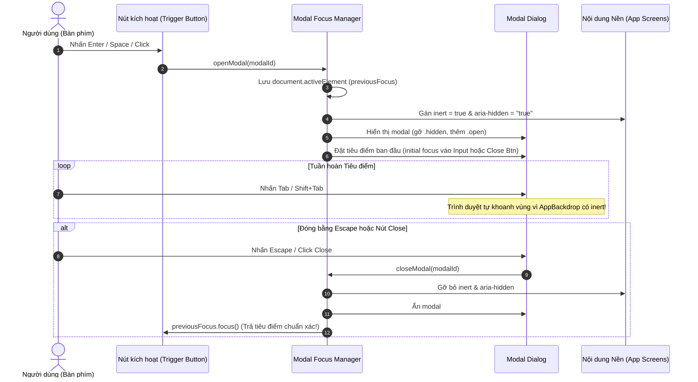

# THIẾT KẾ GIẢI PHÁP TIẾP CẬN TOÀN DIỆN (ACCESSIBILITY REMEDIATION DESIGN)
## Dự án: French Shadowing Studio (FSS)
**Tài liệu:** `audit/menu-navigation/review/ACCESSIBILITY_REMEDIATION_DESIGN.md`  
**Ngày thực hiện:** 2026-11-07  
**Vai trò:** Principal Accessibility Specialist & Senior Frontend Architect  
**Tiêu chuẩn đối chiếu:** WCAG 2.2 Level AA, WAI-ARIA 1.2 Authoring Practices (APG)  
**Chế độ thực thi:** STRICT READ-ONLY REVIEW  

---

## 1. PHÂN LOẠI CÁC THÀNH PHẦN HỘP THOẠI & LỚP PHỦ (DIALOG CLASSIFICATION)

Không áp dụng máy móc mô hình "Modal Dialog" cho tất cả các cửa sổ bật lên. Dưới đây là bảng phân loại chuẩn xác theo W3C WAI-ARIA Authoring Practices:

| Phân loại Thành phần | Danh sách Phần tử trong FSS | Đặc tính Hành vi (Behavioral Spec) | Yêu cầu WCAG Tương ứng |
|---|---|---|---|
| **Modal Dialog (Hộp thoại chặn)** | 1. `punct-modal` (Dấu câu AI) 2. `keyvocab-modal` (Từ khó AI) 3. `bk-import-modal` (Nhập sách) 4. `sentence-edit-modal` (Sửa câu) 5. `vocab-meaning-modal` (Điền nghĩa) 6. `bilingual-modal` (Song ngữ) 7. `vt-ai-modal` (Dịch AI) 8. `bk-tr-modal` (Dịch sách) 9. `modal-art-ai-sync` (Căn mốc AI) 10. `modal-art-level` (Gán CEFR) 11. `share-modal` (Chia sẻ) 12. `tcf-modal` & `tcf-confirm-modal` 13. `fss-cloud-modal` (Đồng bộ) | Khi mở: Vô hiệu hóa tương tác nền, khoanh vùng phím `Tab`, đóng bằng phím `Escape`, trả tiêu điểm về nút kích hoạt khi đóng. | - WCAG 2.1.1 Keyboard - WCAG 2.1.2 No Keyboard Trap - WCAG 2.4.3 Focus Order - WCAG 4.1.2 Name, Role, Value |
| **Non-modal Popover (Cửa sổ cài đặt phụ)** | 1. `#fs-pop` (Cỡ chữ & giãn dòng) 2. `#cc-pop` (Phụ đề video) 3. `#bk-set` (Giao diện đọc sách) 4. `#dc-pop` (Danh sách câu chép chính tả) | Không khóa nền; người dùng vẫn có thể click ra ngoài hoặc tiếp tục nghe audio; đóng bằng Escape hoặc click ngoài; không cần inert nền. | - WCAG 2.1.1 Keyboard - WCAG 1.4.13 Content on Hover or Focus |
| **Sliding Drawer (Ngăn kéo trượt)** | 1. `#mobile-nav-drawer` (Menu mobile trang chủ) 2. `#bk-drawer` (Mục lục sách) | Trượt từ mép màn hình vào; trên mobile đóng vai trò như modal; trên desktop đóng vai trò như sidebar. | - WCAG 2.4.3 Focus Order |
| **Contextual Tooltip (Tra cứu nổi)** | 1. `#lookup-tooltip` (Menu bôi đen tra từ) | Xuất hiện sát vùng bôi đen; tự biến mất khi click ra chỗ khác hoặc bãi bỏ bôi đen. | - WCAG 1.4.13 Content on Hover or Focus |

---

## 2. QUẢN LÝ TIÊU ĐIỂM (MODAL FOCUS MANAGEMENT ARCHITECTURE)

Thay vì viết hàm bẫy phím `Tab` thủ công dễ gây lỗi vòng lặp hoặc xung đột gõ văn bản, FSS sẽ áp dụng **Kiến trúc Quản lý Tiêu điểm 3 bước chuẩn W3C** sử dụng API native hiện đại:

### Ưu điểm vượt trội của giải pháp `inert`:
1. **Hỗ trợ Native 100%:** Thuộc tính HTML `inert` đã được hỗ trợ đầy đủ trên mọi trình duyệt hiện đại (Chrome 102+, Safari 16+, Firefox 105+, Edge 102+).
2. **Triệt tiêu 100% Keyboard Trap rò rỉ:** Khi một phần tử có thuộc tính `inert`, trình duyệt tự động loại bỏ nó khỏi cây Focus Order và cây Trợ năng Accessibility Tree. Người dùng không thể dùng phím `Tab`, chuột, hay phím ảo để tương tác với nội dung nền.
3. **Không cần tính toán mảng DOM Focusable phức tạp:** Tránh được các lỗi kinh điển khi modal có input động hoặc phần tử ẩn hiện có điều kiện.

---

## 3. THIẾT KẾ HÀNH VI PHÍM ESCAPE THEO TỪNG TÌNH HUỐNG (ESCAPE BEHAVIOR SPEC)

Phím `Escape` cần xử lý an toàn tùy thuộc vào trạng thái dữ liệu của từng hộp thoại:

| Tên Hộp Thoại (Modal ID) | Trạng thái Dữ liệu khi mở | Hành vi khi bấm phím `Escape` | Biện pháp Chống Mất Dữ liệu (Data Loss Guard) |
|---|---|---|---|
| `#fss-cloud-modal` | Đang đồng bộ dữ liệu đám mây | **BẬT BẢO VỆ:** Nếu cờ `isSyncing === true`, phím `Escape` bị vô hiệu hóa tạm thời kèm thông báo toast: *"Đang đồng bộ dữ liệu, vui lòng đợi..."*. Nếu đang ở màn hình tĩnh: Đóng ngay lập tức. | Ngăn chặn việc hủy kết nối ngang xương gây hỏng trạng thái Supabase / IndexedDB. |
| `#sentence-edit-modal` | Người dùng đã chỉnh sửa ô textarea | **CẢNH BÁO:** Nếu nội dung textarea khác với câu gốc, hiển thị xác nhận nhanh: *"Hủy các thay đổi chưa lưu?"*. Nếu chưa gõ gì: Đóng ngay. | Chống mất công sức nhập liệu phụ đề của người dùng. |
| `#modal-art-ai-sync` | Đang xử lý gọi AI hoặc có kết quả chưa áp dụng | Nếu tiến trình AI đang chạy: Không đóng. Nếu kết quả đã nạp vào bảng xem trước: Nhấn Escape đóng modal và hủy kết quả tạm. | Bảo toàn luồng xử lý bất đồng bộ. |
| `#punct-modal`, `#keyvocab-modal`, `#vt-ai-modal` | Prompt modal tiêu chuẩn | Đóng ngay lập tức và trả tiêu điểm về nút kích hoạt. | Thao tác nhẹ nhàng, không lưu state nháp. |
| `#tcf-confirm-modal` | Modal lồng (Nested Modal) bên trong bài thi TCF | Nhấn `Escape` chỉ đóng `#tcf-confirm-modal` và trả tiêu điểm về nút "Nộp bài" của bài thi TCF; **tuyệt đối không đóng màn hình làm bài thi TCF**. | Xử lý phân cấp popover đa tầng (Layered Escape Stacking). |

---

## 4. CHUẨN HÓA NHÃN NGỮ NGHĨA TRỢ NĂNG (ARIA SEMANTICS & ACCESSIBLE NAMES)

### 4.1. Bổ sung `aria-labelledby` cho 6 Modal còn thiếu
- **`#share-modal`:** Thêm `id="share-modal-title"` cho thẻ tiêu đề và gắn `aria-labelledby="share-modal-title"` trên container thẻ div `role="dialog"`.
- **`#keyvocab-modal`:** Gắn `aria-labelledby="kv-title"`.
- **`#vocab-meaning-modal`:** Thêm `id="vm-title"` cho tiêu đề và gắn `aria-labelledby="vm-title"`.
- **`#vt-ai-modal`:** Thêm `id="vt-ai-modal-title"` cho tiêu đề và gắn `aria-labelledby="vt-ai-modal-title"`.
- **`#bk-import-modal`:** Bổ sung `role="dialog" aria-modal="true" aria-labelledby="bk-import-title"`.
- **`#bk-tr-modal`:** Bổ sung `role="dialog" aria-modal="true" aria-labelledby="bk-tr-title"`.

### 4.2. Khắc phục Kích thước Vùng chạm (Touch Target Size - WCAG 2.5.8)
1. **Nút "Xóa tất cả" (`partials/view-home.html:510`):**
   - Hiện trạng: Chiều cao thực tế đo qua CDP là **16px** (vi phạm ngưỡng tối thiểu 24px).
   - Thiết kế khắc phục: Thêm class Tailwind `py-1.5 px-2.5 rounded-md hover:fs-surface-subtle` giúp vùng chạm đạt kích thước **60px × 30px**, vượt xa tiêu chuẩn WCAG 2.5.8 mà không làm xô lệch hàng tiêu đề.
2. **Dải nút tốc độ Playback (`css/18-controls-layout.css`):**
   - Thiết kế khắc phục: Bổ sung quy tắc phòng thủ `min-width: 28px` cho các nút tốc độ trong lớp thu nhỏ `.a5` để bảo đảm trên màn hình cảm ứng luôn có đủ diện tích chạm.
