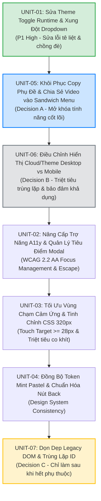

# KẾ HOẠCH HÀNH ĐỘNG KHẮC PHỤC TOÀN DIỆN (COMPREHENSIVE REMEDIATION PLAN)
## Dự án: French Shadowing Studio (FSS)
**Tài liệu:** `audit/menu-navigation/review/COMPREHENSIVE_REMEDIATION_PLAN.md`  
**Cập nhật lần 2:** 2026-11-07 (Đã tích hợp 3 Quyết định Sản phẩm A, B, C)  
**Tác giả:** Principal Frontend Architect & QA Automation Engineer  
**Chế độ thực thi:** KẾ HOẠCH KỸ THUẬT — PLANNING ONLY (Chưa sửa mã nguồn, chờ phê duyệt từng bước)  

---

## 1. NGUYÊN TẮC QUẢN TRỊ & THỰC THI (GOVERNANCE PRINCIPLES)

Toàn bộ quy trình khắc phục và tái cấu trúc hệ thống Menu / Navigation của FSS tuân thủ nghiêm ngặt các quy tắc kỹ thuật sau:
1. **Tuân thủ giới hạn Delivery Unit (`AGENTS.md`):** Mỗi đơn vị can thiệp tối đa 3–5 tệp, không quá 600 dòng code, có tiêu chí nghiệm thu (DoD) đo lường được và kịch bản hoàn tác (Rollback).
2. **Quy trình Post-Split HTML:** Tuyệt đối không sửa tay `index.html`. Mọi cập nhật cấu trúc HTML thực hiện tại `partials/*.html` hoặc `src/index.src.html`, sau đó chạy:
   ```bash
   python3 tools/restructure.py build
   ```
3. **Bảo tồn Classic Scripts:** Giữ nguyên các hàm toàn cục (`window.*`), không tự tiện chuyển sang ES Modules (`type="module"`) hay thêm `defer`/`async` làm đứt gãy inline event handlers.
4. **Bảo vệ Ngân sách Màu & Tokens:** Tuyệt đối không thêm mã màu HEX cứng ngoài token. Xác minh qua `node tools/lint-color.js`.
5. **Cổng Dừng Nghiệm Thu (Stop Gates):** Mỗi đơn vị triển khai phải hoàn tất kiểm thử và được người dùng xác nhận bằng từ khóa phê duyệt trước khi chuyển sang đơn vị tiếp theo.

---

## 2. LỘ TRÌNH 7 ĐƠN VỊ TRIỂN KHAI THEO THỨ TỰ TỐI ƯU (OPTIMAL 7-UNIT ROADMAP)

Thứ tự triển khai được cấu trúc theo **Phương án Hướng Tính Năng & Giá Trị Thực Tế (Feature & Value-First Order)** do người dùng chỉ đạo:



---

### UNIT-01: SỬA LỖI RUNTIME THEME TOGGLE & XUNG ĐỘT MENU TRỰC DIỆN
- **Mục tiêu:** Xóa sổ 100% lỗi Runtime đỏ trong console khi đổi theme tại màn hình dịch; triệt tiêu xung đột mở đè nhau giữa menu đổi giao diện và Sandwich menu.
- **Các Issue xử lý:** `ISSUE-01` (P1), `ISSUE-04` (P1).
- **Phụ thuộc:** Không (Triển khai đầu tiên).
- **Phạm vi tệp can thiệp (2 tệp, ~10 dòng mã):**
  1. [`partials/view-translate.html`](file:///Users/linhvu/AI%20Project/Shadowing/partials/view-translate.html)
  2. [`js/03-practice-engine.js`](file:///Users/linhvu/AI%20Project/Shadowing/js/03-practice-engine.js)
  3. `index.html` (auto-build)
- **Phương án kỹ thuật chi tiết:**
  - Sửa `onclick="toggleTheme()"` thành `onclick="toggleFsTheme()"` tại dòng 13 của `partials/view-translate.html`.
  - Bổ sung lệnh đóng đối ứng: gọi `closeMenu()` trong `togglePracticeMobileMenu` và gọi `window.closePracticeMobileMenu()` trong `pvToggleMenu`.
- **Đánh giá rủi ro:** **Rất thấp (2%)**. (Lỗi cú pháp tiềm ẩn nếu thiếu dấu ngoặc. Giảm thiểu: Chạy CDP test 2 chiều và test suite).
- **Tiêu chí nghiệm thu (DoD):**
  - [ ] Mở màn hình Luyện dịch, bấm nút Chuyển chế độ Sáng / Tối: Chuyển đổi trơn tru, Console 0 lỗi đỏ.
  - [ ] Mở `#pv-menu` rồi bấm `#practice-sandwich-btn`: `#pv-menu` tự động đóng ngay lập tức, không chồng đè.
  - [ ] Mở `#practice-sandwich-menu` rồi bấm `#pv-switch-btn`: Sandwich menu tự đóng ngay lập tức.
  - [ ] `node --test tools/*.test.js` PASS 355/355 (100%).
  - [ ] `node tools/lint-color.js` PASS.
- **Quy trình Hoàn tác (Rollback):**
  - `git checkout partials/view-translate.html js/03-practice-engine.js && python3 tools/restructure.py build`.

---

### UNIT-05: KHÔI PHỤC COPY PHỤ ĐỀ & CHIA SẺ VIDEO VÀO SANDWICH MENU (DECISION A)
- **Mục tiêu:** Đưa hai tính năng cốt lõi `copyTranscript()` và `shareCurrentVideo()` vào `#practice-sandwich-menu`, giúp người dùng tiếp cận dễ dàng trên mọi thiết bị; không làm chật chội Header phụ đề.
- **Các Issue xử lý:** `ISSUE-02` (P2 / Decision A).
- **Phụ thuộc:** `UNIT-01`.
- **Phạm vi tệp can thiệp (2 tệp, ~25 dòng mã):**
  1. [`partials/view-practice.html`](file:///Users/linhvu/AI%20Project/Shadowing/partials/view-practice.html) (Thêm 2 nút vào `#practice-sandwich-menu`)
  2. [`js/01e-translate-ai.js`](file:///Users/linhvu/AI%20Project/Shadowing/js/01e-translate-ai.js) (Đảm bảo class `.copied` animation hoạt động trên nút trong menu)
  3. `index.html` (auto-build)
- **Phương án kỹ thuật chi tiết:**
  - Thêm 2 mục hành động vào Section Tiện ích của `#practice-sandwich-menu`:
    - Nút 1: `Sao chép toàn bộ phụ đề` (`onclick="copyTranscript(); window.closePracticeMobileMenu();"`), kèm icon `data-lucide="copy"`.
    - Nút 2: `Chia sẻ bài học này` (`onclick="shareCurrentVideo(); window.closePracticeMobileMenu();"`), kèm icon `data-lucide="share-2"`.
  - Không tạo thêm thẻ mang ID trùng lặp. Đặt ID riêng cho nút trong menu là `#psm-btn-copy-transcript` và `#psm-btn-share`.
  - Cập nhật hàm `copyTranscript()` tại `js/01e-translate-ai.js:237`: hỗ trợ tìm cả nút trong sandwich menu để bật hiệu ứng sao chép thành công.
- **Đánh giá rủi ro:** **Thấp - Trung bình (5%)**. (Trình duyệt chặn quyền Clipboard API nếu thao tác không gắn với user gesture. Giảm thiểu: Hàm `copyTextToClipboard` đã có sẵn fallback `textarea execCommand`).
- **Tiêu chí nghiệm thu (DoD):**
  - [ ] Mở Sandwich Menu trong phòng luyện: Xuất hiện 2 mục "Sao chép toàn bộ phụ đề" và "Chia sẻ bài học này".
  - [ ] Bấm "Sao chép toàn bộ phụ đề": Nội dung phụ đề được lưu vào Clipboard, Toast thông báo số câu copy xuất hiện, Sandwich menu tự đóng.
  - [ ] Bấm "Chia sẻ bài học này": Hộp thoại Share Modal mở ra với link chia sẻ chính xác, Sandwich menu tự đóng.
  - [ ] Không có lỗi console; tìm kiếm phụ đề không bị ảnh hưởng.
  - [ ] `node --test tools/*.test.js` PASS 100%.
- **Quy trình Hoàn tác (Rollback):**
  - `git checkout partials/view-practice.html js/01e-translate-ai.js && python3 tools/restructure.py build`.

---

### UNIT-06: ĐIỀU CHỈNH HIỂN THỊ CLOUD & THEME DESKTOP VS MOBILE (DECISION B)
- **Mục tiêu:** Áp dụng quy tắc hiển thị đáp ứng chuẩn tại mốc $768\text{px}$: trên Desktop ($> 768\text{px}$) ưu tiên nút Header và ẩn trong Sandwich Menu; trên Mobile ($\le 768\text{px}$) ẩn trên Header và hiển thị trong Sandwich Menu. Bảo đảm tính bất biến Never-Lost.
- **Các Issue xử lý:** `ISSUE-09` (P3 / Decision B).
- **Phụ thuộc:** `UNIT-05`.
- **Phạm vi tệp can thiệp (2 tệp, ~20 dòng mã):**
  1. [`partials/view-practice.html`](file:///Users/linhvu/AI%20Project/Shadowing/partials/view-practice.html) (Gắn class `.psm-mobile-only` cho 2 nút trong Sandwich Menu)
  2. [`css/14-subtitle-card.css`](file:///Users/linhvu/AI%20Project/Shadowing/css/14-subtitle-card.css) (Thêm quy tắc `@media (min-width: 769px)`)
  3. `index.html` (auto-build)
- **Phương án kỹ thuật chi tiết:**
  - Gắn class chuyên biệt `psm-mobile-only` cho nút Đồng bộ đám mây và nút Đổi giao diện trong `#practice-sandwich-menu`.
  - Trong `css/14-subtitle-card.css`, định nghĩa:
    ```css
    @media (min-width: 769px) {
      #practice-sandwich-menu .psm-mobile-only {
        display: none !important;
      }
    }
    ```
  - Căn cứ đúng mốc $\le 768\text{px}$ hiện hành của `#screen-practice header .practice-sync-btn` để không bao giờ xuất hiện vùng chết (gap).
- **Đánh giá rủi ro:** **Thấp (4%)**. (Nguy cơ lệch 1px tại 768px nếu min-width và max-width xung đột. Giảm thiểu: Phân định rạch ròi `max-width: 768px` vs `min-width: 769px`, nghiệm thu qua `MENU_VISIBILITY_ACCEPTANCE_MATRIX.md`).
- **Tiêu chí nghiệm thu (DoD):**
  - [ ] Tại viewport $\ge 769\text{px}$ (Desktop): Header hiển thị nút Cloud & Theme; mở Sandwich menu KHÔNG thấy 2 nút này.
  - [ ] Tại viewport $\le 768\text{px}$ (Mobile/Tablet): Header ẩn nút Cloud & Theme; mở Sandwich menu THẤY đầy đủ 2 nút này.
  - [ ] Tại mốc biên 768px và 769px: Cả 2 tính năng đều khả dụng (Reachable = true), không có điểm chết.
  - [ ] `node --test tools/*.test.js` PASS 100%.
- **Quy trình Hoàn tác (Rollback):**
  - `git checkout partials/view-practice.html css/14-subtitle-card.css && python3 tools/restructure.py build`.

---

### UNIT-02: NÂNG CẤP TRỢ NĂNG A11Y & QUẢN LÝ TIÊU ĐIỂM MODAL
- **Mục tiêu:** Bảo đảm 100% modal dialog tuân thủ WCAG 2.2 AA: hỗ trợ phím `Escape` an toàn, quản lý tiêu điểm bằng `inert`, tự động trả tiêu điểm (focus restoration) khi đóng, và gắn đầy đủ `aria-labelledby`.
- **Các Issue xử lý:** `ISSUE-06` (P2), `ISSUE-07` (P2), `ISSUE-14` (P3).
- **Phụ thuộc:** `UNIT-01`, `UNIT-05`.
- **Phạm vi tệp can thiệp (4 tệp, ~60 dòng mã):**
  1. `js/00-utils.js` (hoặc `js/01-core.js` - Thêm tiện ích `fssOpenModal` & `fssCloseModal` sử dụng `inert`)
  2. [`js/supabase-sync.js`](file:///Users/linhvu/AI%20Project/Shadowing/js/supabase-sync.js) (Thêm Escape listener & focus tracking cho `#fss-cloud-modal`)
  3. [`js/01d-player.js`](file:///Users/linhvu/AI%20Project/Shadowing/js/01d-player.js) (Thêm Escape listener cho `#modal-art-ai-sync` và `#modal-art-level`)
  4. [`partials/modal-share.html`](file:///Users/linhvu/AI%20Project/Shadowing/partials/modal-share.html), [`partials/modal-keyvocab.html`](file:///Users/linhvu/AI%20Project/Shadowing/partials/modal-keyvocab.html), [`partials/modal-book-import.html`](file:///Users/linhvu/AI%20Project/Shadowing/partials/modal-book-import.html)
- **Phương án kỹ thuật chi tiết:** Xem thiết kế chi tiết tại [`ACCESSIBILITY_REMEDIATION_DESIGN.md`](file:///Users/linhvu/AI%20Project/Shadowing/audit/menu-navigation/review/ACCESSIBILITY_REMEDIATION_DESIGN.md).
- **Đánh giá rủi ro:** **Trung bình (6%)**. (Thuộc tính `inert` có thể vô tình khóa nhầm container chứa chính modal nếu cấu trúc DOM lồng nhau. Giảm thiểu: Chỉ gán `inert` trên các container anh em như `#screen-input`, `#screen-practice`, tuyệt đối không gán lên `document.body`).
- **Tiêu chí nghiệm thu (DoD):**
  - [ ] Mở modal: Nhấn phím `Tab` tuần hoàn liên tục không lọt tiêu điểm ra ngoài trang nền.
  - [ ] Nhấn phím `Escape` đóng modal ngay lập tức và trả tiêu điểm chuẩn xác về nút kích hoạt.
  - [ ] Trình đọc màn hình (Screen Reader) đọc to tên modal khi mở.
  - [ ] `node --test tools/*.test.js` PASS 100%.
- **Quy trình Hoàn tác (Rollback):**
  - `git checkout js/00-utils.js js/supabase-sync.js js/01d-player.js partials/modal-*.html && python3 tools/restructure.py build`.

---

### UNIT-03: TỐI ƯU VÙNG CHẠM CẢM ỨNG & TINH CHỈNH RESPONSIVE 320PX
- **Mục tiêu:** Đạt chuẩn kích thước vùng chạm tối thiểu WCAG 2.5.8 ($\ge 24\text{px}$) cho nút "Xóa tất cả"; triệt tiêu 2px co khít mép phải tại viewport 320px; đặt min-width phòng thủ cho nút tốc độ.
- **Các Issue xử lý:** `ISSUE-05` (P3), `ISSUE-11` (P2), `ISSUE-12` (P3).
- **Phụ thuộc:** `UNIT-01`.
- **Phạm vi tệp can thiệp (3 tệp, ~25 dòng mã):**
  1. [`partials/view-home.html`](file:///Users/linhvu/AI%20Project/Shadowing/partials/view-home.html) (Dòng 510)
  2. [`css/05-view-catalog.css`](file:///Users/linhvu/AI%20Project/Shadowing/css/05-view-catalog.css)
  3. [`css/18-controls-layout.css`](file:///Users/linhvu/AI%20Project/Shadowing/css/18-controls-layout.css)
- **Phương án kỹ thuật chi tiết:**
  - Thêm padding `py-1.5 px-2.5 rounded-md` cho nút "Xóa tất cả" để đạt kích thước 60px × 30px.
  - Thêm `@media (max-width: 360px)` ẩn nút 3 cột trong cụm view mode và cho phép `flex-wrap: wrap`.
  - Bổ sung `min-width: 28px` cho nút tốc độ playback trong lớp `.a5`.
- **Đánh giá rủi ro:** **Thấp (3%)**. (Nút phình to làm xô lệch nhẹ hàng tiêu đề video. Giảm thiểu: Dùng class inline-flex và kiểm tra lại trên màn hình 320px).
- **Tiêu chí nghiệm thu (DoD):**
  - [ ] Đo lường qua CDP: Nút "Xóa tất cả" đạt kích thước $\ge 28\text{px}$ chiều cao.
  - [ ] Viewport 320px: `rect.right <= 320px` cho toàn bộ các phần tử trong `.video-catalog-toolbar`, 0px excess.
  - [ ] `node tools/lint-color.js` PASS (không vi phạm token màu).
- **Quy trình Hoàn tác (Rollback):**
  - `git checkout partials/view-home.html css/05-view-catalog.css css/18-controls-layout.css && python3 tools/restructure.py build`.

---

### UNIT-04: ĐỒNG BỘ TOKEN MINT PASTEL CHO CLOUD MODAL & NÚT BACK
- **Mục tiêu:** Chuyển đổi mã màu cứng của Cloud Sync Modal sang hệ thống Semantic Tokens `--fs-*`, bảo đảm hiển thị trang nhã ở chế độ Sáng (Mint Pastel) và sang trọng ở chế độ Tối; chuẩn hóa icon nút Back và nhãn ngữ cảnh.
- **Các Issue xử lý:** `ISSUE-08` (P2), `ISSUE-15` (P3).
- **Phụ thuộc:** `UNIT-02`.
- **Phạm vi tệp can thiệp (3 tệp, ~40 dòng mã):**
  1. [`js/supabase-sync.js`](file:///Users/linhvu/AI%20Project/Shadowing/js/supabase-sync.js) (Dòng 877-896)
  2. [`partials/view-translate.html`](file:///Users/linhvu/AI%20Project/Shadowing/partials/view-translate.html) (Dòng 5)
  3. [`partials/view-book.html`](file:///Users/linhvu/AI%20Project/Shadowing/partials/view-book.html)
- **Phương án kỹ thuật chi tiết:**
  - Thay thế các class Tailwind cứng `bg-[#0b1329] border-blue-900/80` bằng các class Semantic: `fs-surface-card border fs-border-base fs-text-primary`.
  - Chuẩn hóa nút Back: Giữ icon mũi tên trái `←` và nhãn đích đến rõ ràng (`"← Thư viện dịch"`, `"← Tủ sách"`).
- **Đánh giá rủi ro:** **Thấp (3%)**. (Độ tương phản chữ trên nền card ở Dark Mode không đạt chuẩn. Giảm thiểu: Sử dụng trực tiếp class `fs-text-primary` và `fs-text-muted` đã đạt WCAG AAA của dự án).
- **Tiêu chí nghiệm thu (DoD):**
  - [ ] Bật Mint Pastel Light Mode, mở Cloud Sync Modal: Nền trắng thanh thoát, viền xám nhẹ, chữ đen rõ nét.
  - [ ] Bật Dark Mode: Modal tự động chuyển nền tối mà không cần can thiệp CSS riêng.
  - [ ] `node tools/lint-color.js` PASS (0 mã màu HEX cứng phát sinh thêm).
- **Quy trình Hoàn tác (Rollback):**
  - `git checkout js/supabase-sync.js partials/view-translate.html partials/view-book.html && python3 tools/restructure.py build`.

---

### UNIT-07: DỌN DẸP LEGACY DOM & GIẢI QUYẾT TRÙNG LẶP ID (DECISION C)
- **Mục tiêu:** Khử toàn bộ tham chiếu JavaScript đến `#practice-header-tools` và `#sub-search-bar`; xóa bỏ khối HTML đóng băng và loại bỏ ID trùng lặp `#sub-search-input` tại dòng 671.
- **Các Issue xử lý:** `ISSUE-03` (P2), `ISSUE-13` (P3 / Decision C).
- **Phụ thuộc:** `UNIT-01`, `UNIT-05`, `UNIT-06`. (BẮT BUỘC THỰC HIỆN SAU CÙNG).
- **Phạm vi tệp can thiệp (4 tệp, ~50 dòng mã):**
  1. [`js/03-practice-engine.js`](file:///Users/linhvu/AI%20Project/Shadowing/js/03-practice-engine.js) (Dòng 241: kiểm tra null-safe trước khi gọi classList)
  2. [`js/01g-vocab-list.js`](file:///Users/linhvu/AI%20Project/Shadowing/js/01g-vocab-list.js) (Gỡ bỏ các dòng truy vấn `searchBar`)
  3. [`js/08-responsive-height.js`](file:///Users/linhvu/AI%20Project/Shadowing/js/08-responsive-height.js) (Kiểm tra null-safe cho `bar`)
  4. [`partials/view-practice.html`](file:///Users/linhvu/AI%20Project/Shadowing/partials/view-practice.html) (Xóa bỏ `#sub-search-bar` và dọn dẹp `#practice-header-tools`, bảo tồn `#fs-pop`)
- **Phương án kỹ thuật chi tiết:**
  - Tuân thủ quy trình 4 bước an toàn đã thiết kế tại [`DOM_DEPENDENCY_AND_REMOVAL_SAFETY.md`](file:///Users/linhvu/AI%20Project/Shadowing/audit/menu-navigation/review/DOM_DEPENDENCY_AND_REMOVAL_SAFETY.md).
  - Di chuyển `#fs-pop` ra thành popover độc lập nằm trong `#screen-practice` trước khi xóa bỏ khung vỏ `#practice-header-tools`.
- **Đánh giá rủi ro:** **Trung bình - Cao (8%)**. (Nguy cơ lỗi `TypeError: Cannot read properties of null` nếu còn sót 1 hàm JS cũ querySelector ID đã xóa. Giảm thiểu: Chạy kiểm thử toàn diện trên 3 chế độ học và regression suite).
- **Tiêu chí nghiệm thu (DoD):**
  - [ ] Không còn thẻ input trùng lặp: `document.querySelectorAll('#sub-search-input').length === 1`.
  - [ ] Khối HTML chết `#sub-search-bar` được loại bỏ hoàn toàn khỏi DOM.
  - [ ] Chuyển đổi qua lại giữa Mặc định, Shadowing, Chép chính tả: Console 0 lỗi đỏ.
  - [ ] Bấm "Cỡ chữ & Giãn dòng" trong Sandwich menu: Cửa sổ `#fs-pop` vẫn mở bình thường.
  - [ ] `node --test tools/*.test.js` PASS 355/355 (100%).
- **Quy trình Hoàn tác (Rollback):**
  - `git checkout partials/view-practice.html js/03-practice-engine.js js/01g-vocab-list.js js/08-responsive-height.js && python3 tools/restructure.py build`.
