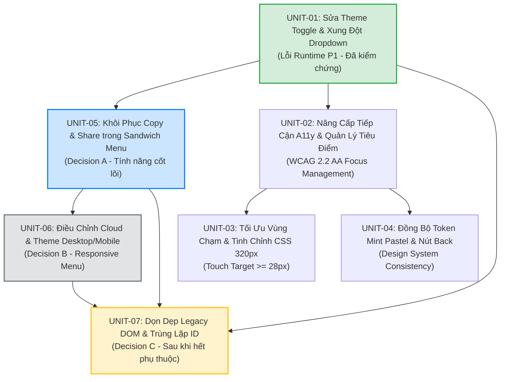

# MA TRẬN PHỤ THUỘC & THỨ TỰ TRIỂN KHAI TỐI ƯU
## (DELIVERY DEPENDENCY MATRIX & OPTIMAL SEQUENCE)
### Dự án: French Shadowing Studio (FSS)
**Tài liệu:** `audit/menu-navigation/review/DELIVERY_DEPENDENCY_MATRIX.md`  
**Ngày lập:** 2026-11-07  
**Vai trò:** Principal Frontend Architect & Technical Planning Agent  
**Chế độ thực thi:** PLANNING ONLY  

---

## 1. ĐỒ THỊ PHỤ THUỘC GIỮA 7 ĐƠN VỊ TRIỂN KHAI (DEPENDENCY GRAPH)

---

## 2. PHÂN TÍCH SO SÁNH HAI PHƯƠNG ÁN THỨ TỰ TRIỂN KHAI

### Phương án A: Thứ tự theo Trục Kỹ thuật Kiến trúc (Architecture-First Order)
`UNIT-01` $\rightarrow$ `UNIT-02` (A11y) $\rightarrow$ `UNIT-03` (Responsive) $\rightarrow$ `UNIT-04` (Theme) $\rightarrow$ `UNIT-05` (Copy/Share) $\rightarrow$ `UNIT-06` (Visibility) $\rightarrow$ `UNIT-07` (Cleanup).
- *Ưu điểm:* Giải quyết nền tảng trợ năng (A11y) và token trước khi đụng vào tính năng.
- *Nhược điểm:* Người dùng phải chờ qua 3 đơn vị kỹ thuật nền mới thấy được tính năng Copy Transcript và Chia sẻ video — hai tính năng thiết thực nhất trong học tập hàng ngày.

### Phương án B (KHUYẾN NGHỊ BỞI PRODUCT OWNER): Thứ tự Hướng Tính Năng & Trải Nghiệm (Feature & Value-First Order)
`UNIT-01` $\rightarrow$ `UNIT-05` (Copy/Share) $\rightarrow$ `UNIT-06` (Cloud/Theme Visibility) $\rightarrow$ `UNIT-02` (A11y) $\rightarrow$ `UNIT-03` (Touch/320px) $\rightarrow$ `UNIT-04` (Theme Tokens) $\rightarrow$ `UNIT-07` (Legacy DOM Cleanup).
- *Ưu điểm vượt trội:*
  1. **Hiệu quả tức thì (Immediate Value):** Sau khi UNIT-01 dập tắt lỗi đỏ console, UNIT-05 mở khóa ngay 2 tính năng bị giam cầm trong DOM ẩn bấy lâu nay.
  2. **Hoàn thiện trọn vẹn Sandwich Menu:** UNIT-05 (thêm Copy/Share) và UNIT-06 (ẩn nút Cloud/Theme trên desktop) đều thao tác tập trung vào `#practice-sandwich-menu`, giúp giảm thiểu số lần mở/đóng và test giao diện này.
  3. **Cô lập triệt để rủi ro:** Đơn vị dọn dẹp Legacy DOM (`UNIT-07`) được đẩy về sau cùng, bảo đảm mọi tính năng mới đã vận hành ổn định trong production mới tiến hành khử rác.

$\Rightarrow$ **KẾT LUẬN: Chọn Phương án B làm lộ trình thực thi chính thức.**

---

## 3. BẢNG CHI TIẾT MA TRẬN 7 ĐƠN VỊ TRIỂN KHAI (DELIVERY UNITS MATRIX)

| Đơn vị (Unit) | Tiêu đề & Mục tiêu | Các Issue Xử lý | Phụ thuộc (Dependencies) | Danh mục Tệp Can thiệp (Max $\le 5$) | Rủi ro Tiềm ẩn & Giảm thiểu | Lệnh Kiểm thử Nghiệm thu | Cổng Phê duyệt (Approval Gate) |
|---|---|---|---|---|---|---|---|
| **UNIT-01** | **Sửa lỗi Runtime Theme Toggle & Xung đột Dropdown** | `ISSUE-01` `ISSUE-04` | Không | - `partials/view-translate.html` - `js/03-practice-engine.js` - `index.html` (auto-build) | **Rủi ro Thấp (2%):** Lỗi cú pháp JS gây treo sự kiện toggle. Giảm thiểu: Chạy CDP test 2 chiều và test suite. | `node --test tools/*.test.js` `node audit/menu-navigation/test_m42_verification.js` | Người dùng đã duyệt nguyên tắc; chờ duyệt commit. |
| **UNIT-05** | **Khôi phục Copy Transcript & Share Video vào Sandwich Menu** | `ISSUE-02` | `UNIT-01` | - `partials/view-practice.html` - `js/01e-translate-ai.js` - `index.html` (auto-build) | **Rủi ro Trung bình (5%):** Quyền Clipboard bị trình duyệt chặn hoặc Toast không hiện. Giảm thiểu: Kế thừa hàm `copyTextToClipboard` có fallback `textarea`. | Mở video $\rightarrow$ Bấm Copy: kiểm tra clipboard text và toast. Bấm Share: kiểm tra modal xuất hiện. | Cần duyệt thẻ Module Card M43. |
| **UNIT-06** | **Điều chỉnh Hiển thị Cloud & Theme Desktop vs Mobile** | `ISSUE-09` | `UNIT-05` | - `partials/view-practice.html` - `css/14-subtitle-card.css` - `index.html` (auto-build) | **Rủi ro Trung bình (4%):** Xuất hiện điểm ngắt trung gian làm ẩn cả 2 vị trí. Giảm thiểu: Căn cứ chính xác mốc 768px theo `MENU_VISIBILITY_ACCEPTANCE_MATRIX.md`. | Kiểm thử 9 viewport qua CDP: $\le 768\text{px}$ hiện Sandwich, $\ge 769\text{px}$ hiện Header. | Cần duyệt thẻ Module Card M44. |
| **UNIT-02** | **Nâng cấp Tiếp cận A11y & Quản lý Tiêu điểm Modal** | `ISSUE-06` `ISSUE-07` `ISSUE-14` | `UNIT-01` | - `js/00-utils.js` - `js/supabase-sync.js` - `js/01d-player.js` - `partials/modal-*.html` | **Rủi ro Trung bình (6%):** Thuộc tính `inert` vô tình khóa nhầm container chứa modal. Giảm thiểu: Chỉ inert các screen anh em (`#screen-input`, `#screen-practice`), không inert `body`. | Nhấn `Tab` tuần hoàn trong 13 modal; bấm `Escape` đóng modal; kiểm tra Accessibility Tree. | Cần duyệt thẻ Module Card M45. |
| **UNIT-03** | **Tối ưu Vùng chạm Cảm ứng & Tinh chỉnh CSS 320px** | `ISSUE-05` `ISSUE-11` `ISSUE-12` | `UNIT-01` | - `partials/view-home.html` - `css/05-view-catalog.css` - `css/18-controls-layout.css` | **Rủi ro Thấp (3%):** Nút phình to làm vỡ hàng tiêu đề video. Giảm thiểu: Chỉ tăng padding dọc `py-1.5`, không đổi font size. | Đo lường CDP: Nút "Xóa tất cả" cao $\ge 28\text{px}$, toolbar 320px có excess = 0. | Cần duyệt thẻ Module Card M46. |
| **UNIT-04** | **Đồng bộ Token Mint Pastel cho Cloud Modal & Nút Back** | `ISSUE-08` `ISSUE-15` | `UNIT-02` | - `js/supabase-sync.js` - `partials/view-translate.html` - `partials/view-book.html` | **Rủi ro Thấp (3%):** Lệch màu tương phản ở Dark Mode. Giảm thiểu: Chạy `node tools/lint-color.js` và kiểm tra độ tương phản. | Bật Light Mode $\rightarrow$ Mở Cloud Modal: Nền trắng thanh thoát, chữ đen rõ nét. | Cần duyệt thẻ Module Card M47. |
| **UNIT-07** | **Dọn dẹp Legacy DOM & Giải quyết Trùng lặp ID** | `ISSUE-03` `ISSUE-13` | `UNIT-01` `UNIT-05` `UNIT-06` | - `partials/view-practice.html` - `js/03-practice-engine.js` - `js/01g-vocab-list.js` - `js/08-responsive-height.js` | **Rủi ro Cao (8%):** Lỗi Null pointer nếu còn sót truy vấn DOM cũ. Giảm thiểu: Tuân thủ quy trình 4 bước kiểm tra null phòng thủ trước khi xóa HTML. | `node --test tools/*.test.js` PASS 100%. Console 0 lỗi khi đổi 3 chế độ học. | Cần duyệt thẻ Module Card M48. |

---

## 4. QUY TẮC CẤP MÃ MODULE ID THEO `PROJECT_STATUS.MD`

Theo quy định tại `AGENTS.md` và `PROJECT_STATUS.md`:
- Module hoàn thành gần nhất trên Git HEAD là **M41** (`bf9e9d2`).
- Kế hoạch này sử dụng các mã danh xưng tạm thời (`UNIT-01` đến `UNIT-07`).
- Khi người dùng chính thức phê duyệt từng bước, Antigravity sẽ cấp phát tuần tự các mã module chính thức:
  - `UNIT-01` $\rightarrow$ **M42** (Đã thực hiện xong mã nguồn, chờ lệnh commit).
  - `UNIT-05` $\rightarrow$ **M43**.
  - `UNIT-06` $\rightarrow$ **M44**.
  - `UNIT-02` $\rightarrow$ **M45**.
  - `UNIT-03` $\rightarrow$ **M46**.
  - `UNIT-04` $\rightarrow$ **M47**.
  - `UNIT-07` $\rightarrow$ **M48**.
