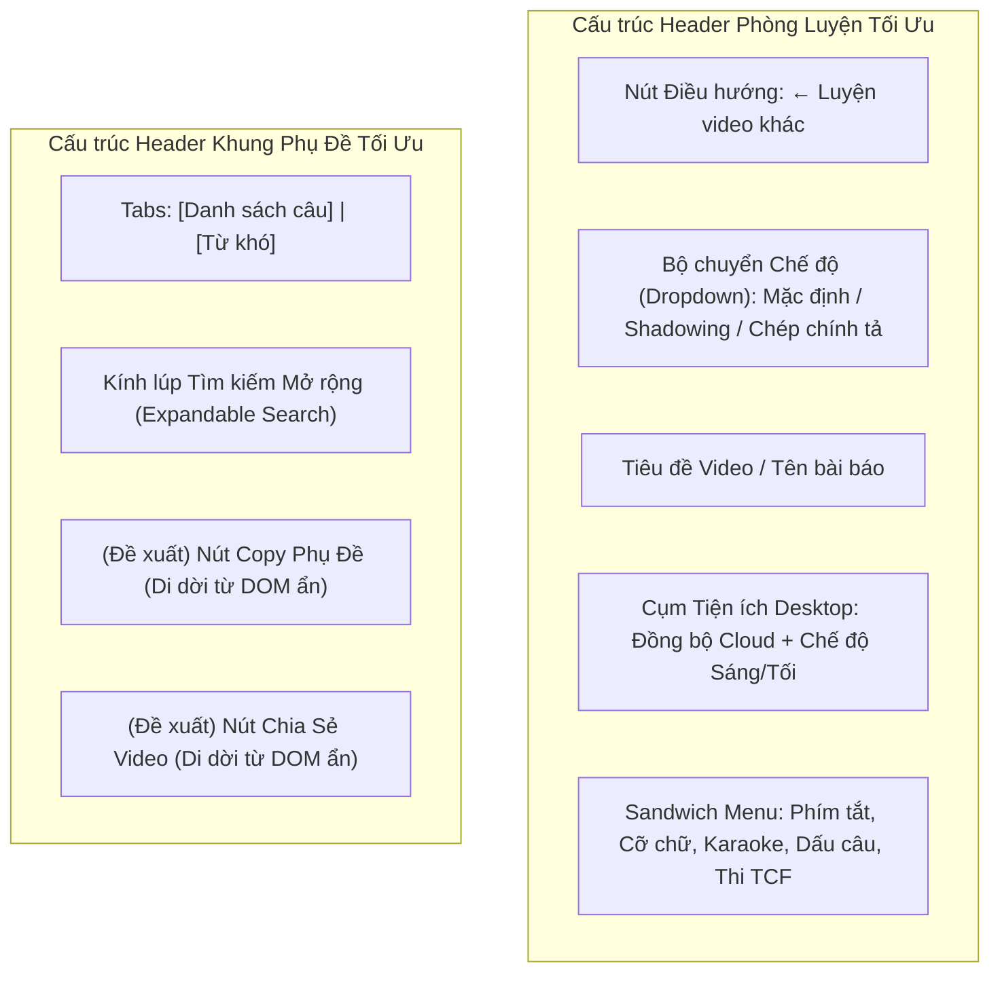

# ĐÁNH GIÁ KIẾN TRÚC ĐIỀU HƯỚNG & HỆ THỐNG MENU (MENU ARCHITECTURE REVIEW)
## Dự án: French Shadowing Studio (FSS)
**Tài liệu:** `audit/menu-navigation/review/MENU_ARCHITECTURE_REVIEW.md`  
**Ngày thực hiện:** 2026-11-07  
**Vai trò:** Principal Frontend Architect & Senior UI/UX Engineer  
**Chế độ thực thi:** STRICT READ-ONLY REVIEW  

---

## 1. PHÂN CẤP ĐIỀU HƯỚNG TỔNG THỂ (NAVIGATION HIERARCHY)

French Shadowing Studio (FSS) được xây dựng theo mô hình **Single Page Application (SPA) Hybrid** với điều hướng dựa trên URL hash (`#/practice/...`, `#/translate/...`) kết hợp chuyển đổi trạng thái hiển thị của các màn hình lớn (`#screen-input`, `#screen-practice`, `#screen-vocab`, `#screen-book`, `#screen-vt`, `#screen-guide`) thông qua thuộc tính `.hidden` và class CSS.

```mermaid
graph TD
    AppRoot["French Shadowing Studio (Root SPA)"] --> ScreenInput["Màn hình 1: Trang chủ (#screen-input)"]
    AppRoot --> ScreenPractice["Màn hình 2: Phòng Luyện tập (#screen-practice)"]
    AppRoot --> ScreenVocab["Màn hình 3: Sổ Từ Vựng (#screen-vocab)"]
    AppRoot --> ScreenBook["Màn hình 4: Đọc Sách (#screen-book)"]
    AppRoot --> ScreenVT["Màn hình 5: Luyện Dịch (#screen-vt)"]
    AppRoot --> ScreenGuide["Màn hình 6: Hướng Dẫn (#screen-guide)"]

    ScreenInput --> TopNavHome["Header Trang chủ (MN-01 / MN-02)"]
    ScreenInput --> CatalogToolbar["Toolbar Danh mục & Lịch sử (MN-28 / MN-29)"]
    ScreenInput --> InputAccordions["Accordions Nhập liệu (MN-34)"]

    ScreenPractice --> TopNavPractice["Header Phòng luyện (MN-03)"]
    TopNavPractice --> ViewSwitcher["Đổi Chế độ: Mặc định / Shadowing / Chép chính tả (MN-04)"]
    TopNavPractice --> SandwichMenu["Sandwich Menu Tiện ích (MN-05)"]
    ScreenPractice --> PlayerArea["Video / Audio Player Controls (MN-08 / MN-11)"]
    ScreenPractice --> SubtitleArea["Khung Phụ đề & Danh sách câu (MN-09 / MN-10 / MN-12)"]
    ScreenPractice --> DictationArea["Giao diện Chép chính tả & Bàn phím ảo (MN-15 / MN-16 / MN-17)"]
    ScreenPractice --> SidePanelArea["Sidebar Bài báo & Gán cấp độ CEFR (MN-13 / MN-32 / MN-33)"]

    ScreenVocab --> VocabTop["Header & Hành động Sổ từ vựng (MN-18)"]
    ScreenVocab --> VocabFilters["Bộ lọc, Tìm kiếm & Chọn danh mục (MN-19)"]
    ScreenVocab --> VocabHub["Trung tâm Luyện từ VPH Modal (MN-20 / MN-21)"]

    ScreenBook --> BookTop["Header Đọc sách (MN-22)"]
    ScreenBook --> BookDrawer["Mục lục & Tìm kiếm (MN-23)"]
    ScreenBook --> BookSettings["Cài đặt Giao diện đọc (MN-24)"]
    ScreenBook --> BookBottom["Thanh Điều hướng trang (MN-25)"]

    ScreenVT --> VTHeader["Header Luyện dịch (MN-26)"]
    ScreenVT --> VTNav["Thanh Điều hướng câu dịch (MN-27)"]
```

---

## 2. QUYỀN SỞ HỮU & QUẢN TRỊ MENU (MENU OWNERSHIP)

Mỗi menu trong hệ thống thuộc về một phân hệ chịu trách nhiệm độc lập:

1. **Phân hệ Toàn cục (Global & Shared Layer):**
   - **Thành phần:** Theme Toggle (`toggleFsTheme`), Cloud Sync Modal (`#fss-cloud-modal`), Selection Tooltip (`#lookup-tooltip`), Sổ từ vựng nút tắt (`openVocabScreen`).
   - **Tệp quản trị:** `src/index.src.html`, `js/supabase-sync.js`, `js/01-main.js`.
2. **Phân hệ Trang chủ & Video Catalog:**
   - **Thành phần:** `MN-01`, `MN-02`, `MN-28`, `MN-29`, `MN-34`.
   - **Tệp quản trị:** `partials/view-home.html`, `js/01-main.js`, `css/05-view-catalog.css`.
3. **Phân hệ Phòng Luyện tập (Practice Engine):**
   - **Thành phần:** `MN-03` đến `MN-10`, `MN-14` đến `MN-17`.
   - **Tệp quản trị:** `partials/view-practice.html`, `js/03-practice-engine.js`, `js/01d-player.js`.
4. **Phân hệ Sổ Từ Vựng & Luyện Flashcard:**
   - **Thành phần:** `MN-18`, `MN-19`, `MN-20`, `MN-21`.
   - **Tệp quản trị:** `partials/view-vocab.html`, `js/01g-vocab-list.js`, `js/vocab-practice.js`.
5. **Phân hệ Đọc Sách (E-Book Reader):**
   - **Thành phần:** `MN-22`, `MN-23`, `MN-24`, `MN-25`.
   - **Tệp quản trị:** `partials/view-book.html`, `js/01h-ebook.js`.
6. **Phân hệ Luyện Dịch (Translation Engine):**
   - **Thành phần:** `MN-26`, `MN-27`.
   - **Tệp quản trị:** `partials/view-translate.html`, `js/05-translate-engine.js`.

---

## 3. PHÂN TÍCH TRÙNG LẶP & ĐỐI CHIẾU LỐI TẮT NGỮ CẢNH (CONTROL DUPLICATION)

Không phải mọi sự trùng lặp đều là "rác" hoặc "nợ kỹ thuật". Phân loại chính xác 5 nhóm trùng lặp hiện có:

### 3.1. Trùng lặp Đáp ứng Đa thiết bị có Chủ đích (Intentional Responsive Duplication)
- **Ví dụ:** Header Desktop (`MN-01`) vs Mobile Navigation Drawer (`MN-02`).
- **Bản chất:** Trên Desktop, các tab nhập liệu (Video, Bài báo, Đọc sách, Luyện dịch) hiển thị dạng thanh tab ngang rộng. Trên màn hình di động $< 640\text{px}$, các tab này được ẩn đi và chuyển thành các mục trong Drawer menu trượt xuống khi bấm nút Hamburger (`#btn-mobile-menu`).
- **Đánh giá:** **100% HỢP LÝ VÀ CHUẨN MỰC UX.** Tuyệt đối không xóa bỏ.

### 3.2. Lối tắt Tiện ích theo Ngữ cảnh (Useful Contextual Shortcut)
- **Ví dụ 1:** Nút "Đồng bộ Cloud" và "Đổi Theme" vừa nằm trên Header phòng luyện (`MN-03.3`, `MN-03.4`), vừa nằm trong Sandwich Menu (`MN-05.1`, `MN-05.2`).
- **Bản chất:** Trên Desktop, người dùng có thể bấm trực tiếp trên Header với 1 cú click. Trên Mobile, các nút trên header thu nhỏ thành icon không kèm chữ; người dùng mới hoặc người dùng thích duyệt menu tập trung có thể mở Sandwich menu để đọc rõ nhãn văn bản tiếng Việt.
- **Đánh giá:** **HỢP LÝ VỀ TRẢI NGHIỆM.** Báo cáo audit cũ coi đây là lỗi P2 là nhận định chủ quan. Khuyến nghị giữ nguyên, hoặc chỉ ẩn ở Sandwich menu trên màn hình lớn nếu người dùng yêu cầu tinh gọn.
- **Ví dụ 2:** Nút "Song ngữ" trên thanh điều khiển video và nút "Sửa bản dịch song ngữ" trong Sandwich menu.
- **Bản chất:** Bật/tắt song ngữ là thao tác tức thời, trong khi sửa/tải lại bản dịch là thao tác quản trị dữ liệu. Đặt cạnh nhau trong Sandwich menu là hoàn toàn logic.

### 3.3. Trùng lặp Gây Xung đột Kỹ thuật (Conflict Duplication — Cần khắc phục)
- **Ví dụ:** Menu đổi giao diện (`#pv-menu`) và Sandwich menu (`#practice-sandwich-menu`).
- **Bản chất:** Cả 2 menu đều là cửa sổ nổi (`dropdown card`) neo vào thanh header. Khi mở menu này thì không đóng menu kia, khiến 2 menu đè lên nhau gây rối mắt và làm tiêu điểm bàn phím nhảy hỗn loạn.
- **Đánh giá:** **LỖI THỰC SỰ (ISSUE-04 - P1).** Cần bổ sung lệnh đóng đối ứng.

### 3.4. Mã Rác Trùng lặp DOM Đóng băng (Dead DOM Duplication — Cần dọn dẹp thận trọng)
- **Ví dụ:** Cụm nút cũ `#practice-header-tools` (dòng 58-200) và ô tìm kiếm cũ `#sub-search-bar` (dòng 664-699) trong `partials/view-practice.html`.
- **Bản chất:** Toàn bộ các chức năng này đã được di chuyển vào Sandwich Menu (`#practice-sandwich-menu`) và Header phụ đề (`#sub-search-expandable`), nhưng mã cũ vẫn bị để lại với thuộc tính `style="display:none !important;"`.
- **Đánh giá:** **NỢ KỸ THUẬT (ARCHITECTURAL DEBT).** Phải dọn dẹp theo quy trình 2 bước: gỡ bỏ tham chiếu trong JavaScript trước, sau đó mới xóa HTML.

---

## 4. BẤT NHẤT TRONG HỆ THỐNG ĐIỀU HƯỚNG QUAY LẠI (BACK NAVIGATION INCONSISTENCY)

Audit cũ đề xuất biến mọi nút Back thành nhãn `"← Trang chủ"`. Thẩm định phân tích chuyên sâu chỉ ra rằng đây là đề xuất sai lầm về mặt ngữ nghĩa (Semantics):

| Màn hình | Nút Back Hiện tại | Đích đến Thật sự (Destination) | Hành vi State | Phân tích Ngữ nghĩa | Đề xuất Chuẩn hóa |
|---|---|---|---|---|---|
| **Phòng Luyện tập** | `"Luyện video khác"` (`backToInputScreen()`) | Màn hình Trang chủ (`#screen-input`) | Hủy video, dừng audio, lưu tiến độ | Người dùng vừa học xong một bài, mục tiêu là chọn bài khác để luyện. Nhãn hiện tại rất trực quan. | Giữ nguyên nhãn `"← Luyện video khác"` hoặc `"← Kho video"` kèm icon chevron. |
| **Màn hình Luyện dịch** | `"Thư viện"` (`vtClose()`) | Tab Luyện dịch trong `#screen-input` | Lưu trạng thái câu đang dịch | Người dùng quay về danh mục các bài dịch mẫu, không phải trang chủ video. | Nhãn `"← Thư viện dịch"` chính xác hơn nhiều so với `"Trang chủ"`. |
| **Màn hình Đọc sách** | `"Quay lại"` (`bkClose()`) | Màn hình trước đó | Lưu trang sách đang đọc dở | Trả về ngữ cảnh trước đó. | Chuẩn hóa `"← Tủ sách"` hoặc `"← Quay lại"`. |
| **Màn hình Hướng dẫn** | `"Về trang chủ"` / `"Quay lại Studio"` | Đóng overlay hướng dẫn | Giữ nguyên view bên dưới | Chỉ là đóng modal hướng dẫn. | Chuẩn hóa `"✕ Đóng hướng dẫn"` hoặc `"← Quay lại"`. |

**Quy tắc thiết kế mới:**
1. **Icon thống nhất:** Luôn sử dụng icon mũi tên trái chuẩn `lucide="arrow-left"` hoặc chevron-left với kích thước cố định $16\text{px} \times 16\text{px}$.
2. **Công thức nhãn ngữ cảnh:** `[Icon mũi tên] + [Tên Đích đến Ngữ cảnh]`. Tuyệt đối không dùng chữ "Trang chủ" khi đích đến là Thư viện bài dịch hay Tủ sách.

---

## 5. ĐỀ XUẤT CẢI THIỆN KIẾN TRÚC THÔNG TIN (PROPOSED IA IMPROVEMENT)

### Rationale (Lý do thiết kế):
- **Header phòng luyện:** Giữ nguyên các chức năng cốt lõi, bổ sung logic Mutual Exclusive giữa Dropdown chế độ và Sandwich Menu để triệt tiêu 100% hiện tượng đè nhau.
- **Header phụ đề:** Nếu người dùng phê duyệt khôi phục tính năng Copy và Share, đưa 2 icon gọn gàng cạnh ô kính lúp tìm kiếm trong `#sub-panel-hd`. Đây là vị trí người dùng tìm kiếm văn bản tự nhiên nhất.
