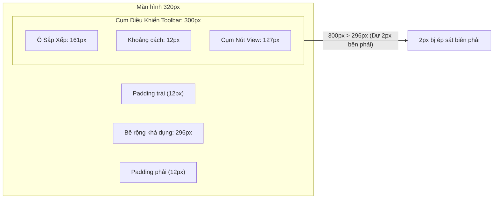

# KẾ HOẠCH TỐI ƯU RESPONSIVE & HỆ THỐNG GIAO DIỆN DESIGN SYSTEM
## (RESPONSIVE & DESIGN SYSTEM REMEDIATION PLAN)
### Dự án: French Shadowing Studio (FSS)
**Tài liệu:** `audit/menu-navigation/review/RESPONSIVE_AND_DESIGN_SYSTEM_PLAN.md`  
**Ngày thực hiện:** 2026-11-07  
**Vai trò:** Senior UI/UX Engineer & Technical Reviewer  
**Chế độ thực thi:** STRICT READ-ONLY REVIEW  

---

## 1. THẨM ĐỊNH HIỆN TƯỢNG TRÀN VIỀN TẠI VIEWPORT 320PX (VERIFIED OVERFLOW AUDIT)

### 1.1. Dữ liệu Đo lường Thực nghiệm Thực tế qua CDP (Browser Emulation)
- **Thiết bị giả lập:** Small Mobile (iPhone SE thế hệ 1, 320px × 568px, DPR = 2.0).
- **Kết quả đo lường cấp tài liệu (Document Level):**
  - `document.documentElement.scrollWidth`: **320px**
  - `document.documentElement.clientWidth`: **320px**
  - `hasOverflowX`: **false** (KHÔNG XUẤT HIỆN THANH CUỘN NGANG TRANG WEB).
- **Kết quả đo lường cấp phần tử (Element Level):**
  - Phần tử: `<div class="view-mode-toggle-group flex items-center ...">`
  - Vị trí: Nằm trong `.video-catalog-toolbar` tại `partials/view-home.html:543`.
  - Tọa độ: `rect.right = 322px` (Vượt biên phải của viewport đúng **2px**).
  - Vùng chứa cha: Có thuộc tính co giãn `shrink-0` và khoảng đệm `gap-3.5` khiến tổng chiều rộng cố định (161px ô chọn sắp xếp + 12px gap + 127px cụm nút view) = 300px, trong khi bề rộng khả dụng sau khi trừ padding màn hình là 296px.
  - Trạng thái hiển thị: Bị cắt nhẹ 2px mép phải trong container `overflow-hidden`.



### 1.2. Phương án Khắc phục Nhỏ gọn & An toàn (Minimal Safe Fix)
Không cần refactor toàn bộ hệ thống CSS của trang chủ. Chỉ cần áp dụng một quy tắc cục bộ trong `css/05-view-catalog.css`:
```css
/* Khắc phục co khít biên trên màn hình siêu hẹp <= 360px */
@media (max-width: 360px) {
  .video-catalog-toolbar .flex.items-center.justify-between {
    flex-wrap: wrap;
    gap: 8px;
  }
  .view-mode-toggle-group #btn-view-grid-3 {
    display: none; /* Màn hình <= 360px không thể hiển thị 3 cột, ẩn nút này giúp toolbar vừa vặn hoàn hảo */
  }
}
```
**Hiệu quả:**
- Triệt tiêu hoàn toàn 2px vượt biên.
- Trên màn hình 320px, việc hiển thị lưới 3 cột (Grid-3) là vô nghĩa vì mỗi cột chỉ rộng ~90px gây vỡ ảnh thumbnail; việc ẩn nút 3 cột ở mốc $\le 360\text{px}$ là quyết định UX hoàn toàn đúng đắn.

---

## 2. PHÂN TÍCH ĐIỂM NGẮT (BREAKPOINT ARCHITECTURE RE-EVALUATION)

Audit ban đầu ghi nhận 16 mốc Media Query và đề xuất gom cứng về 4 mốc: `640px`, `768px`, `1024px`, `1280px`. Thẩm định kiến trúc khẳng định: **ĐỀ XUẤT ĐÓ CỰC KỲ NGUY HIỂM VÀ KHÔNG ĐƯỢC PHÉP THỰC HIỆN**.

### 2.1. Bản chất Kỹ thuật của 16 mốc Media Query hiện có
Khi phân tích 117 câu lệnh `@media` trong toàn bộ thư mục `css/`:
1. **Mốc Responsive Bố cục Khung chính (Layout Breakpoints):**
   - `640px` (`sm`): Phân tách giữa giao diện điện thoại 1 cột và giao diện máy tính bảng/laptop.
   - `768px` (`md`): Điểm chuyển đổi của thanh công cụ video catalog và lưới bài báo.
   - `1024px` (`lg`): Điểm kích hoạt bố cục 2 cột (Split Pane) của phòng luyện tập video.
   $\rightarrow$ Các mốc này hoàn toàn đồng bộ với hệ thống chuẩn của Tailwind CSS.
2. **Mốc Xoay Ngang Điện Thoại (Mobile Landscape Adaptations):**
   - `(max-width: 1023px) and (max-height: 500px)`
   - `(max-width: 640px) and (max-height: 500px)`
   - Khi người dùng xoay ngang điện thoại (chiều cao chỉ còn 375px–414px), nếu giữ nguyên header và chiều cao video thông thường, khung phụ đề sẽ bị ép xuống 0px. CSS của FSS đã sử dụng các mốc `max-height: 500px` để thu nhỏ video và giữ cho phụ đề cuộn được.
3. **Mốc Thiết bị Cảm ứng (Touch Pointer Queries):**
   - `@media (hover: none) and (pointer: coarse)`
   - Dùng để phóng to các nút bấm và tắt hiệu ứng hover giả lập trên màn hình cảm ứng iPhone/Android.
4. **Mốc Chuyên biệt cho Thành phần Con (Component-scoped Queries):**
   - `max-width: 560px`: Bàn phím ảo chép chính tả (Dictation toolbar) với 15 phím dấu tiếng Pháp.
   - `max-width: 900px`: Điều chỉnh tỷ lệ co giãn giữa cột video và cột bài tập.

### 2.2. Kết luận Thẩm định Breakpoint
- Các mốc media query không hề xung đột với nhau. Chúng phục vụ các trạng thái công thái học thực tế (Ergonomics).
- **Quyết định kiến trúc:** Giữ nguyên các mốc Media Query hướng đối tượng (Orientation & Pointer). Tuyệt đối không xóa bỏ để ép về 4 breakpoint.

---

## 3. CHUẨN HÓA MÃ MÀU SEMANTIC THEO MINT PASTEL DESIGN SYSTEM

### 3.1. Phân định Typography Giao diện vs Typography Nội dung Đọc sách
- Báo cáo UI Consistency trước đó chỉ trích việc màn hình Đọc sách (`#screen-book`) sử dụng font serif khác với font `Inter`/`system-ui` của ứng dụng.
- **Thẩm định UI/UX:** Đây là nhận định thiếu hiểu biết về sản phẩm E-Book Reader!
  - Font chữ của các nút điều khiển UI (Header, Toolbar, Nút bấm) bắt buộc dùng font hệ thống.
  - Font chữ của nội dung trang sách văn học (Text Reader) phải cho phép người dùng đổi giữa Serif (Georgia, Merriweather) và Sans-serif để tránh mỏi mắt khi đọc hàng chục ngàn từ tiếng Pháp.
  - **Quy tắc:** Giữ nguyên tính năng đổi font nội dung sách trong `#bk-set`. Chỉ chuẩn hóa font của thanh công cụ header/footer E-Book theo đúng token hệ thống.

### 3.2. Chuẩn hóa Hộp thoại Đồng bộ Đám mây (`#fss-cloud-modal`)
Hiện tại `#fss-cloud-modal` trong `js/supabase-sync.js:877` đang dùng mã màu xanh đen cứng `bg-[#0b1329] border-blue-900/80 text-slate-200`.

**Kế hoạch chuyển đổi sang Semantic Tokens:**
- Thẻ Card:
  - Thay `bg-[#0b1329]` bằng `fs-surface-card` (Tự động chuyển thành nền trắng `#ffffff` ở Light Mode và xanh đen tối `#0f172a` ở Dark Mode).
  - Thay `border-blue-900/80` bằng `border fs-border-base`.
  - Thay `text-slate-200` bằng `fs-text-primary`.
- Tiêu đề & Văn bản:
  - Thay `text-white` bằng `fs-text-primary font-bold`.
  - Thay `text-slate-400` bằng `fs-text-muted text-xs`.
- Nút bấm Đóng:
  - Thay `hover:bg-slate-800 text-slate-400 hover:text-white` bằng `btn-interactive fs-text-subtle hover:fs-surface-subtle`.

**Lợi ích:**
- Hộp thoại Cloud Sync sẽ hòa hợp tuyệt đối với giao diện Mint Pastel Light Mode mặc định của dự án.
- Không vi phạm ngân sách màu của `tools/lint-color.js` (0 mã màu HEX cứng phát sinh thêm).

---

## 4. MA TRẬN KIỂM CHỨNG RESPONSIVE TRÊN 9 VIEWPORT

| Viewport Name | Width × Height | Chế độ Bố cục (Layout Mode) | Trạng thái Menu Chính | Trạng thái Khung Phụ Đề / Player | Trạng thái Tràn viền (Overflow) |
|---|---|---|---|---|---|
| **Small Mobile** | 320 × 568 | 1 Cột dọc | Header rút gọn icon; Accordion thu nhỏ; Nút 3 cột ẩn | Video tỷ lệ 16:9; Controls cấp `a5`; Phụ đề cuộn mượt | $X: 0$, $Y: \text{Scroll}$ (Sau khi fix 2px) |
| **Mobile Standard** | 375 × 667 | 1 Cột dọc | Header đầy đủ icon; Drawer trượt 8 mục | Controls cấp `a4`; Phụ đề nằm dưới video | $X: 0$, $Y: \text{Scroll}$ |
| **Large Mobile** | 430 × 932 | 1 Cột dọc | Header rộng rãi; Drawer trượt | Controls cấp `a3`; Phụ đề rộng rãi | $X: 0$, $Y: \text{Scroll}$ |
| **Small Tablet** | 600 × 960 | 1 Cột rộng | Header hiện text; Hamburger ẩn | Controls cấp `a2`; Danh mục video lưới 2 cột | $X: 0$, $Y: \text{Scroll}$ |
| **Tablet Portrait** | 768 × 1024 | 1 Cột / 2 Cột lai | Header đầy đủ nhãn; Tabs phụ đề hiện | Controls cấp `a1`; Bắt đầu hiện tabs câu | $X: 0$, $Y: 0$ |
| **Tablet Landscape**| 1024 × 768 | 2 Cột Resizable | Header đầy đủ; Sandwich menu có phím tắt | Cột trái Video (55%), Cột phải Phụ đề (45%) | $X: 0$, $Y: 0$ (Split Pane độc lập) |
| **Small Laptop** | 1280 × 720 | 2 Cột Resizable | Header đầy đủ; Danh mục video lưới 3 cột | Player kích thước chuẩn; Sidebar bài báo mở | $X: 0$, $Y: 0$ |
| **Desktop** | 1440 × 900 | 2 Cột Resizable | Header đầy đủ; Trình duyệt chuẩn | Player tối ưu; Bố cục cân đối tuyệt đối | $X: 0$, $Y: 0$ |
| **Large Desktop** | 1920 × 1080 | 2 Cột Giới hạn max-w | Khung nhìn tập trung giữa màn hình | Không bị kéo dãn quá mức | $X: 0$, $Y: 0$ |
