# BÁO CÁO PHÂN TÍCH CHI TIẾT TÍNH NĂNG "ĐỌC BÁO TIẾNG PHÁP"
**Dự án:** French Shadowing Studio  
**Phân hệ:** Đọc báo & Văn bản thuần (`currentInputMode = 'text'` / `body.text-mode`)  
**Ngày thực hiện:** 27/10/2026  

---

## I. TỔNG QUAN TÍNH NĂNG (OVERVIEW & OBJECTIVES)

Tính năng **"Đọc báo"** (hay còn gọi là chế độ luyện văn bản thuần - Text Shadowing Mode) là một trong những trụ cột học tập cốt lõi của **French Shadowing Studio**, bên cạnh các chế độ *Luyện Video*, *Đọc sách*, *Luyện dịch Việt → Pháp* và *Video của bạn*.

### 1. Mục tiêu đào tạo
- Cho phép người học tiếp cận nguồn tư liệu thời sự tiếng Pháp thực tế (*Français authentique*) từ các cơ quan báo chí chính thống của Pháp (RFI, Le Monde, France 24, Le Figaro, TV5Monde, Courrier International).
- Khắc phục nhược điểm của việc học qua video: không bị phân tâm bởi hình ảnh chuyển động, người học tập trung hoàn toàn vào kỹ năng đọc hiểu (*Compréhension écrite*), cấu trúc ngữ pháp và trau dồi vốn từ vựng học thuật/thời sự.
- Tích hợp công nghệ AI và công cụ ngôn ngữ: Tách câu thông minh, dịch song ngữ Pháp – Việt theo ngữ cảnh, tra cứu từ điển Larousse tức thì, phát âm giọng Pháp chuẩn bản xứ qua Web Speech API / TTS và đồng bộ từ vựng vào hệ thống ôn tập ngắt quãng (SRS).

---

## II. DANH MỤC CÁC TỆP NGUỒN CẤU THÀNH (FILE INVENTORY)

| Phân loại | Đường dẫn tệp | Vai trò kỹ thuật trong tính năng Đọc báo |
|---|---|---|
| **Giao diện HTML** | [partials/view-home.html](file:///Users/linhvu/AI%20Project/Shadowing/partials/view-home.html) (Dòng 105–233) | Khung nhập liệu `#text-input-mode`: Lối tắt 6 trang báo, khung dán text, bộ đếm từ, nút upload file, hàng lịch sử `#text-history-container`, lưới bài đọc mẫu `#art-lib-grid`. |
| **Giao diện HTML** | [partials/view-practice.html](file:///Users/linhvu/AI%20Project/Shadowing/partials/view-practice.html) (Dòng 185–250) | Khung đọc bài `#screen-practice`: Chứa thẻ `#article-side-panel`, khung văn bản đọc cuộn `#subtitles-scroll-container`, thanh công cụ trên đỉnh. |
| **Kiểu dáng CSS** | [css/02-base.css](file:///Users/linhvu/AI%20Project/Shadowing/css/02-base.css) (Dòng 115–220) | Định kiểu thẻ tab Đọc báo, lưới trang báo `.fr-news-grid`, khung nhập văn bản `.txt-card`, các chip tính năng `.txt-chips`. |
| **Kiểu dáng CSS** | [css/03-layout.css](file:///Users/linhvu/AI%20Project/Shadowing/css/03-layout.css) (Dòng 77–80 & 1307–1326) | Ẩn nửa trái chứa video YouTube (`.split-panel-left`), mở rộng khung bài đọc ra 100% (`max-width: 960px` căn giữa chuẩn văn bản báo chí). |
| **Kiểu dáng CSS** | [css/06-view-news.css](file:///Users/linhvu/AI%20Project/Shadowing/css/06-view-news.css) | Định kiểu hàng thẻ bài đọc Netflix-style, nút mở rộng xem thêm, tối ưu hóa cho màn hình di động/tablet. |
| **Kiểu dáng CSS** | [css/09-text-mode-fix.css](file:///Users/linhvu/AI%20Project/Shadowing/css/09-text-mode-fix.css) | File chuyên trách cưỡng chế ẩn `#panel-left`, `.split-resizer` và bung toàn màn hình cho `#panel-right`. |
| **Kiểu dáng CSS** | [css/theme-light.css](file:///Users/linhvu/AI%20Project/Shadowing/css/theme-light.css) (Dòng 4332–4460) | Hệ thống biến màu và thiết kế Mint Pastel cho thẻ thông tin bài đọc `.art-side-card`. |
| **Xử lý Logic** | [js/01d-player.js](file:///Users/linhvu/AI%20Project/Shadowing/js/01d-player.js) | Thuật toán tách câu `splitProseIntoSentences`, hàm khởi tạo `enterTextShadowing`, điều khiển phiên đọc `openTextSession`, phân tích file (.docx, .md, .html, .txt), tải thư viện bài mẫu `loadArticleLibrary`. |
| **Xử lý Logic** | [js/01g-vocab-list.js](file:///Users/linhvu/AI%20Project/Shadowing/js/01g-vocab-list.js) (Dòng 2576–2617) | Hàm `importArticleFromExtension(p)` tiếp nhận bài báo bôi đen được gửi từ Extension/Userscript trình duyệt. |
| **Xử lý Logic** | [js/01e-translate-ai.js](file:///Users/linhvu/AI%20Project/Shadowing/js/01e-translate-ai.js) | Render danh sách câu đọc `.sentence-text-line`, xử lý click/hover từng từ, hiển thị dòng dịch tiếng Việt `.sub-vi-line`. |
| **Xử lý Logic** | [js/01-core.js](file:///Users/linhvu/AI%20Project/Shadowing/js/01-core.js) (Dòng 188–250) | Động cơ âm thanh `window.playFrenchAudio`: Phát âm câu/từ tiếng Pháp qua Web Speech API với fallback Google Translate TTS. |
| **Điều hướng & Router** | [js/01h-ebook.js](file:///Users/linhvu/AI%20Project/Shadowing/js/01h-ebook.js) (Dòng 1735–1836) | Điều hướng liên kết URL băm: `#/articles` (vào thẳng tab Đọc báo), nạp bài qua ID `art_lib_<id>`. |

---

## III. KIẾN TRÚC KỸ THUẬT & LUỒNG DỮ LIỆU (TECHNICAL ARCHITECTURE)

```mermaid
flowchart TD
    subgraph INGESTION["1. NGUỒN NẠP DỮ LIỆU (Data Ingestion)"]
        A1["Dán văn bản trực tiếp<br/>(#text-shadow-textarea)"]
        A2["Tải tệp lên máy<br/>(.txt, .docx, .md, .html)"]
        A3["Extension / Userscript<br/>(Bôi đen trang web -> Import)"]
        A4["Thư viện bài mẫu<br/>(articles/ hoặc fallback CEFR)"]
    end

    subgraph PROCESSING["2. TIỀN XỬ LÝ & PHÂN ĐOẠN (Processing)"]
        B1["Giải nén DOCX / Parse DOM HTML / Markdown"]
        B2["Tạo mã băm ổn định<br/>docId = 'txt_' + textDocHash(rawText)"]
        B3["splitProseIntoSentences()<br/>Bảo vệ chữ viết tắt, số thập phân -> Cắt theo dấu chấm"]
        B4["Gán mốc thời gian tuần tự<br/>id, startTime, endTime, text"]
    end

    subgraph STORAGE["3. LƯU TRỮ & ĐỒNG BỘ (Persistence)"]
        C1[("localStorage: STORAGE_KEY<br/>isText: true, sentences, title")]
        C2[("Supabase Cloud Sync<br/>Bản ghi bài đọc & từ vựng")]
        C3[("IndexedDB: txiPut<br/>Lưu trữ ảnh minh họa bài báo")]
    end

    subgraph ENGINE["4. GIAO DIỆN PHÒNG ĐỌC (#screen-practice)"]
        D1["Thiết lập isTextMode = true<br/>Thêm body.text-mode"]
        D2["Ẩn Video YouTube & Timeline<br/>Mở rộng Reader 960px"]
        D3["Render danh sách câu & ảnh<br/>.sub-textmode-container"]
    end

    subgraph INTERACTION["5. TƯƠNG TÁC NGƯỜI HỌC (Interactive Learning)"]
        E1["Click từ / Space: Phát âm TTS<br/>window.playFrenchAudio()"]
        E2["Bôi đen chữ: Tra từ điển Larousse<br/>Hiện IPA, ngữ pháp & lưu từ"]
        E3["Bật / Tắt Song ngữ Pháp - Việt<br/>(.sub-vi-line, toggleBilingual)"]
        E4["Trợ lý AI dịch & trích từ khó<br/>openKeyVocabModal()"]
    end

    INGESTION --> PROCESSING
    PROCESSING --> STORAGE
    PROCESSING --> ENGINE
    ENGINE --> INTERACTION
    STORAGE -.->|"Nhận diện bài cũ<br/>Giữ lại bản dịch AI"| ENGINE
```

---

## IV. ĐẶC TẢ CHI TIẾT CÁC PHÂN HỆ CHỨC NĂNG

### 1. Phân hệ Nạp dữ liệu (Trang chủ `partials/view-home.html`)
- **Lối tắt 6 cơ quan báo chí Pháp:** Giao diện gồm 6 card tương tác với logo nhận diện màu sắc riêng (RFI đỏ, Le Monde vàng đen, France 24 xanh da trời, Le Figaro xanh navy, TV5Monde tím, Courrier International cam), mở trực tiếp sang nguồn báo gốc bằng một cú nhấp chuột.
- **Khung soạn thảo văn bản thông minh:**
  + Tự động đếm số từ (*Word Count*) theo thời gian thực.
  + Tự động nhận diện dòng đầu tiên làm tiêu đề nếu người dùng không điền tiêu đề riêng.
  + Hỗ trợ nút kéo thả/chọn file linh hoạt với định dạng phong phú: `.txt`, `.docx` (Word), `.md` (Markdown), `.html` (Web lưu trữ).
- **Bộ đọc tệp độc lập (Client-side Parsers):**
  + Tự động phân tích cấu trúc DOCX bằng bộ đọc zip nhị phân viết tay (`bkZipEntries` / `bkZipRead`), bóc tách các thẻ Heading làm tiêu đề đoạn, trích xuất hình ảnh trong file Word thành Base64 Data URL để hiển thị liền mạch trong bài đọc.
  + Parse mã nguồn HTML qua `DOMParser`, tự động dọn sạch các thẻ rác (`<script>`, `<style>`, `<nav>`, `<iframe>`), giữ lại nội dung chính.

### 2. Thuật toán tách câu tiếng Pháp (`splitProseIntoSentences`)
Tiếng Pháp có nhiều từ viết tắt có dấu chấm dễ gây ngắt câu sai (*false sentence boundaries*). Thuật toán áp dụng cơ chế 3 lớp bảo vệ:
1. **Lớp 1 - Từ điển viết tắt:** Nạp danh sách viết tắt danh xưng (`M.`, `Mme.`, `Mlle.`, `Dr.`, `Pr.`), viết tắt thông dụng (`p.ex.`, `c.-à-d.`, `etc.`, `cf.`), các tháng trong năm (`jan.`, `fév.`, `oct.`...).
2. **Lớp 2 - Tên riêng & Số thập phân:** Sử dụng regex Lookbehind/Lookahead để bảo vệ chữ cái tên đệm viết tắt (ví dụ: *Charles de G.*) và các số thập phân (*3.14*).
3. **Lớp 3 - Thay thế ký tự kiểm soát tạm thời:** Chuyển đổi các dấu chấm nội bộ thành ký tự điều khiển `\u0001`, sau đó mới thực hiện tách câu theo dấu kết thúc câu thực sự (`.`, `!`, `?`, `…`), cuối cùng phục hồi lại ký tự gốc.

### 3. Phân hệ Phòng đọc bài (`#screen-practice` ở `body.text-mode`)
- **Tối ưu thị giác chuyên nghiệp:**
  + Vô hiệu hóa và ẩn hoàn toàn khung video YouTube, timeline và các phím chức năng video (Karaoke, Cuộn theo tiếng, Lặp lại đoạn A-B).
  + Chuyển cấu trúc màn hình từ 2 cột tỉ lệ 5:7 thành 1 cột trung tâm rộng 960px, cỡ chữ tối ưu cho mắt, khoảng cách dòng thoáng (line-height 1.75).
- **Phát âm đa kênh (Speech Synthesis Pipeline):**
  + Ưu tiên 1: Sử dụng Web Speech API của trình duyệt với các giọng đọc tiếng Pháp chất lượng cao (Google Français, Thomas, Amélie, Audrey).
  + Ưu tiên 2 (Failsafe): Nếu trình duyệt không hỗ trợ hoặc lỗi giọng đọc, tự động chuyển tiếp sang luồng âm thanh HTML5 Audio của Google Translate TTS (`tl=fr&client=tw-ob`).
- **Tra cứu từ điển & Ngữ pháp (Contextual Lookup):**
  + Bôi đen bất kỳ từ hoặc cụm từ nào sẽ kích hoạt popup tra cứu: Phiên âm quốc tế IPA (dữ liệu từ `assets/french-ipa.txt`), từ điển Larousse trực tuyến, phát âm chuẩn và nút lưu vào kho từ vựng cá nhân.
- **Dịch song ngữ AI (Bilingual Integration):**
  + Cho phép hiển thị song ngữ Pháp - Việt bên dưới từng câu.
  + Hỗ trợ nạp file dịch sẵn `<tên_bài>_vi.txt` hoặc xuất dữ liệu để nhờ AI dịch theo từng đoạn/câu.
  + Ghi nhớ bản dịch theo mã băm nội dung (`textDocHash`). Khi người dùng quay lại đọc một bài báo đã từng luyện, hệ thống nạp lại toàn bộ bản dịch song ngữ mà không phải dịch lại từ đầu.

---

## V. ĐÁNH GIÁ ƯU ĐIỂM & ĐIỂM MẠNH (KEY STRENGTHS)

1. **Tận dụng tối đa hệ sinh thái sẵn có (Zero Overhead Architecture):**
   Thay vì phải viết một trình đọc hoàn toàn mới, tác giả đã khéo léo ánh xạ cấu trúc văn bản báo chí vào mảng dữ liệu `sentences` của trình phát phụ đề video. Nhờ đó, tính năng Đọc báo thừa hưởng ngay lập tức:
   - Toàn bộ động cơ tra cứu từ điển Larousse và phát âm.
   - Hệ thống lưu từ vựng, đánh dấu từ khó, phân loại từ theo SRS.
   - Công cụ dịch song ngữ AI và bộ đếm tiến độ bài học.
2. **Hỗ trợ đa dạng phương thức nạp tư liệu:**
   Người học có thể nhập liệu bằng bất kỳ cách nào: copy-paste văn bản, tải file `.txt`/`.docx`/`.md`/`.html`, hoặc dùng Userscript/Extension để gửi thẳng bài báo từ bất kỳ trang web nào về studio chỉ bằng 1 cú nhấp chuột.
3. **Cơ chế Fallback mẫu rất chu đáo:**
   Khi chưa có thư mục dữ liệu bài viết trên server, hệ thống không bị lỗi trắng trang mà tự động hiển thị 3 bài báo mẫu được biên soạn kỹ theo 3 trình độ A2, B1, B2 với đầy đủ số lượng từ và tóm tắt nội dung.
4. **Hệ thống nhận diện mã băm thông minh (`textDocHash`):**
   Giúp lưu lại tiến độ đọc và bản dịch tiếng Việt cho từng bài báo vào `localStorage` và Supabase mà không làm trùng lặp dữ liệu.

---

## VI. CÁC HẠN CHẾ & VẤN ĐỀ PHÁT HIỆN QUA RÀ SOÁT CODE

Qua quá trình rà soát chi tiết mã nguồn dự án, đã phát hiện 4 điểm hạn chế kỹ thuật đáng chú ý:

> [!WARNING]
> ### 1. Thẻ thông tin bài đọc (`#article-side-panel`) bị ẩn hoàn toàn do xung đột CSS
> - **Hiện trạng trong code:** Tại [js/01d-player.js#L564-L670](file:///Users/linhvu/AI%20Project/Shadowing/js/01d-player.js#L564-L670), hàm `renderArticleSidePanel()` được viết rất công phu: hiển thị thông tin bài đọc, logo nguồn báo (RFI, Le Monde...), tổng số từ, tổng số câu, trạng thái lưu tự động, nút "Sao chép bài", nút "Dịch song ngữ", và danh sách 8 từ vựng quan trọng được AI trích xuất.
> - **Nguyên nhân lỗi:** Thẻ HTML `
` được đặt bên trong `#panel-left` (tại [partials/view-practice.html#L192](file:///Users/linhvu/AI%20Project/Shadowing/partials/view-practice.html#L192)). Tuy nhiên, trong [css/09-text-mode-fix.css](file:///Users/linhvu/AI%20Project/Shadowing/css/09-text-mode-fix.css) và [css/03-layout.css](file:///Users/linhvu/AI%20Project/Shadowing/css/03-layout.css), rule `body.text-mode #panel-left { display: none !important; }` lại ẩn toàn bộ `#panel-left` để giấu video YouTube.
> - **Hậu quả:** Toàn bộ thẻ thông tin bài đọc này bị ẩn khỏi mắt người dùng khi vào chế độ đọc báo!

### 2. Thiếu thư mục dữ liệu `articles/` trên kho lưu trữ
- Hiện tại trong cây thư mục gốc chưa có thư mục `articles/` và tệp chỉ mục `articles/articles.json`.
- Do đó, mục "Thử đọc bài viết có sẵn" trên trang chủ luôn phải rơi vào trạng thái Fallback (chỉ có 3 bài mẫu hardcode sẵn trong JS).

### 3. Trải nghiệm mở báo ngoài còn thủ công
- 6 nút bấm chuyển đến các trang báo (RFI, France 24...) hiện đơn thuần là thẻ `<a target="_blank">`.
- Người học bấm vào sẽ nhảy sang tab mới, phải tự bôi đen bài báo, sao chép rồi quay lại app dán vào. Chưa có tính năng xem RSS feed các tin nóng trong ngày để đọc ngay tại chỗ.

### 4. Chưa có bộ chỉnh thị giác nâng cao cho người đọc báo
- Chế độ "Đọc sách" (`#screen-book` trong [css/04-view-reader.css](file:///Users/linhvu/AI%20Project/Shadowing/css/04-view-reader.css)) sở hữu bộ công cụ thị giác rất mạnh mẽ: đổi 4 themes (Dark, Dim, Sepia - bảo vệ mắt, Paper - trang giấy), đổi 3 bộ phông chữ (Literata Serif, Georgia, Plus Jakarta Sans), căn lề và khoảng cách dòng.
- Trong khi đó, chế độ "Đọc báo" hiện tại bị khóa cứng theo giao diện tối của app với phông sans-serif mặc định, chưa cho phép người học đổi sang nền Sepia/giấy báo để đọc các bài báo dài mà không mỏi mắt.

---

## VII. ĐỀ XUẤT LỘ TRÌNH CẢI TIẾN & NÂNG CẤP (RECOMMENDATIONS)

Dựa trên phân tích trên, xin đề xuất lộ trình cải tiến theo 3 giai đoạn:

### Giai đoạn 1: Sửa lỗi hiển thị & Tối ưu bố cục (Ưu tiên cao)
1. **Khôi phục thẻ thông tin bài đọc (`#article-side-panel`):**
   - Đưa thẻ `#article-side-panel` ra khỏi `#panel-left`, đặt làm phần Header đầu bài hoặc thanh công cụ cố định trên đỉnh trang đọc báo (hoặc chuyển thành thanh Sidebar bên phải có thể đóng/mở).
   - Đảm bảo hiển thị đầy đủ: Nguồn báo, tổng số từ, thời gian đọc ước tính, các từ vựng tiêu biểu trong bài và nút "Sao chép bài viết".

### Giai đoạn 2: Bổ sung kho dữ liệu bài đọc phong phú
1. **Khởi tạo thư mục `articles/` trên repo:**
   - Tạo file `articles/articles.json`.
   - Bổ sung 10–15 bài báo tiếng Pháp mẫu kèm file dịch song ngữ `_vi.txt` theo các chủ đề hấp dẫn: Văn hóa Pháp, Ẩm thực, Khoa học công nghệ, Môi trường, Lối sống (Art de vivre), phân loại từ A1 đến C1.

### Giai đoạn 3: Nâng cấp trải nghiệm độc giả chuyên sâu
1. **Bổ sung Reader Toolbar (Theme & Typography):**
   - Mang các tính năng của Book Reader sang Đọc báo: Chế độ nền vàng ấm Sepia / Chế độ giấy sáng Paper để đọc ban ngày.
   - Cho phép tùy chỉnh font chữ (Serif báo chí như Times / Literata / Merriweather).
2. **Tích hợp RSS Tin tức thời sự cập nhật hàng ngày:**
   - Tích hợp RSS feed công khai của *RFI Français Facile* hoặc *France 24*: Người học mở tab Đọc báo là thấy ngay danh sách 5–10 bài tin thời sự nóng nhất hôm nay để chọn đọc ngay chỉ bằng 1 click.
